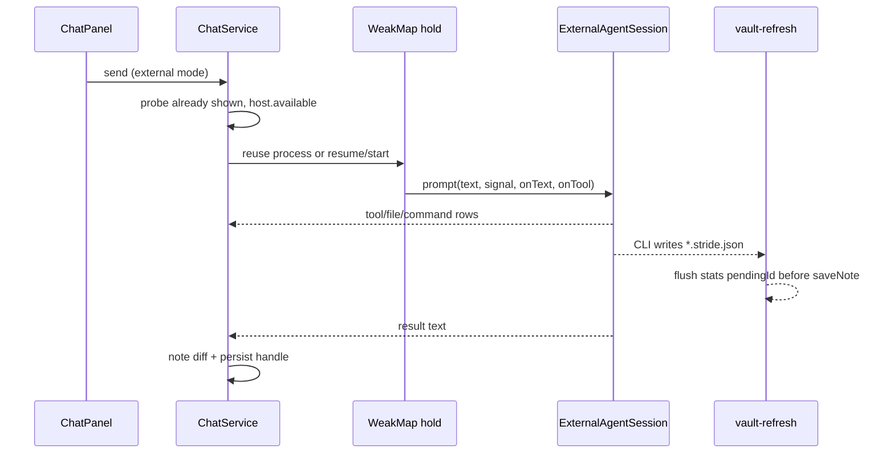
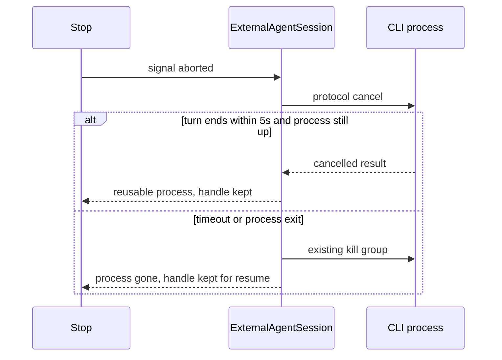

# 外部 CLI 会话、可见性与笔记安全

> 状态：Draft
> 作者：placeholder
> 日期：2026-11-13
> 目标路径：`/Users/ximing/project/mygithub/stride/docs/agent-session-design.md`
> 范围：`packages/core` 的外部 CLI 客户端、上下文快照与强力工具；`packages/platform` 与 `apps/desktop/electron` 的进程白名单；`apps/desktop/src/services/chat`、`settings`、`vault`；聊天面板。不改产品代码。

本文解决一次使用评审里确认要做的九件事：外部 CLI 的工具与文件可见、进程死后的续接、发送前的可执行文件状态、笔记不被压平成纯文本、停止时保留会话、路径变更丢掉已持有进程、外部改盘的差异与撤销、以及内置上下文截断必须对模型可见。浏览器里三个 CLI 模式继续显示但禁用，不得落入内置助手。

## 1. 背景

`ChatService.send` 在模式是 `grok`、`claude` 或 `codex` 时走 `sendExternal`，并且在 `llmRuntime` 检查之前返回。内置 Safe / Power 才进入 `playChatTurn` → `runAgentLoop`。外置路径只把当前输入交给 `ExternalAgentSession.prompt`，不把已落盘的 transcript 交给 CLI。连续性只存在于还活着的那个进程。

进程挂在模块级 `WeakMap` 上，键是 `raw(ChatService)`，值的 key 是 `${vault.activeVaultId}:${session.id}:${mode}`。`newSession`、`close`、vault key 变化时的 `ensureLoaded`、`openFromHistory`、删除当前会话、`setAgentMode` 真正换模式、以及 `sendExternal` 的任何错误（含 abort）都会 `dropExternalAgent()`。`dropExternalAgent` 调 `session.stop()`，也就是杀掉进程。直接写 `vault.agentMode = ...` 不会立刻杀进程；下一次 `externalSession` 因 key 不同才会杀。`ChildProcess` 不能放进 rabjs Service，否则代理会触发 `Illegal invocation`。这一点保持不变。

渲染侧 `apps/desktop/src/services/platform/agent-process.ts` 在 `dataListeners.size === 0` 时把 stdout 积在 `stdoutBuffer`，第一次 `onData` 回放并清空；exit 记在 `exitInfo` 里，订阅时补发。Claude 的 init 帧会在 `spawn` 返回之前写到 stdout，这个缓冲是正确性的一部分。本文不改它。

## 2. 现状

### 2.1 三条 CLI 只留下正文

`packages/platform/src/agent-process.ts` 的 `EXTERNAL_AGENT_SPAWN` 不传 `--model`：

| 模式 | argv |
|---|---|
| claude | `-p --output-format stream-json --input-format stream-json --verbose --permission-mode bypassPermissions --disallowedTools AskUserQuestion` |
| codex | `app-server --listen stdio://` |
| grok | `--no-auto-update agent --always-approve stdio` |

`ClaudeClient.textFromContent` 只拼接 `type === 'text'`。`control_request` 在 `ingest` 里自动回 `behavior: 'allow'`，不进队列。`waitForInit` 读到 `system` 帧上的 `session_id` 就返回，然后丢掉。`CodexClient.prompt` 和 `GrokClient.prompt` 只把文本交给 `onText`。Codex 的 `item/*` 里非 `agentMessage` / `text` 被 `itemText` 丢掉，包括 `commandExecution` 和 `fileChange`。Grok 的 `session/update` 只取 `content` 字符串或 `content.text`。助手消息因此永远是 `tools: []`、`thinking: ''`。面板里的工具 UI（`chat-panel.tsx` 的 `ChatTools` / `ChatTool`，`data-testid="chat-tool"`）只服务内置工具。

主进程限制已经存在，不提高：`MAX_SESSIONS` 4、单次 stdin `MAX_WRITE` 1MB、stdout 块 8KB、stderr 尾 4KB。`cwd` 必须是已存在的绝对目录。`shell: false`，stdio pipe，POSIX 上 `detached` 进程组。macOS 没有 `setsid`。非绝对 cwd（内存夹具）不拉起进程，返回不可用。

### 2.2 停止、换模式、重启都是新进程

`abort()` 只 `controller.abort()`。`ExternalAgentSession.prompt` 的 abort 监听调用 `stop()`，`catch` 里再 `stop()` 一次。`sendExternal` 的 `catch` 无条件 `dropExternalAgent()`，并把 abort 显示成 `external-agent-aborted`。协议上可以取消一轮而不退出的能力没有使用。

会话正文在 app data 的 `chats/<vaultKey>/<id>.json`，元信息在同目录 `.meta.json`。`vaultKey` 来自 `VaultService.activeVaultId` 的 SHA-256 前 16 位，不是 `rootLabel`。`format` 仍是 `1`。`openFromHistory` 恢复 `messages` 和 `transcript`，然后丢掉 CLI。`ensureLoaded` 在 vault key 变化时换成空白会话。History 按 vault 隔离。

### 2.3 可执行文件只在设置里，而且只填 `null`

`AgentExecutables` 的三个字段都是 `string | null`，存在应用设置，不进 vault。

| 存储值 | 含义 | 探测 |
|---|---|---|
| `null` | 从未设置 | `fillDetectedExecutables` 可以写入 |
| `''` | 用户清空，用登录 PATH 上的裸命令名 | 不得再填 |
| 非空字符串 | spawn 命令，trim 后使用 | 不得覆盖 |

`normalizeAgentExecutable`：非字符串、长度 > 4096、含 NUL → `null`；trim 后的 `''` 保持 `''`。`agentExecutableCommand`：非字符串、`''` 或空白 → 裸模式名，否则用 trim 后的字符串。`commandFor` 只在 `spec.command` 本身是模式名且容器里有 `SettingsService` 时改写命令。协议客户端不读设置。

主进程 `acceptedArgs`：裸模式名，或 `~/` 展开后的绝对路径且 basename stem 是 `grok` / `claude` / `codex`（去掉 `.exe` / `.cmd`）。参数必须与该模式的 canonical argv 逐项相等。拒绝 `--model`、`--model=`、相对路径和其他 basename。绝对命令由 `environmentFor` 把 `dirname(command)` 加到 PATH 前面（Windows 是 `Path`），这样 `#!/usr/bin/env node` 用到旁边的 node。探测在 `apps/desktop/electron/agent-which.ts`：登录 PATH 一次缓存，然后 fnm / nvm 最高 semver，再 volta / asdf；跳过 `node_modules`；存 shim 不存 realpath。IPC 是 `agent:which`。

设置页字段是 `data-testid="agent-exec-grok|claude|codex"`。本地草稿 `onChange` 立刻把字符串写进 `form` 并保存，避免迟到的预填盖住用户刚改的值。预填只替换仍为 `null` 的字段。

发送前，composer 只在 `data-testid="chat-external-model"` 上写「使用 CLI 自己的默认模型」或「不可用」。不显示将要执行的路径，也不检查文件是否还在。二进制后来被挪走时，非 `null` 的旧路径一直留着，直到用户自己清空。已持有的进程继续用拉起时的命令，直到被 drop。

### 2.4 笔记文件与 shell

Safe 只有读工具。Power 在 `WRITE_VAULT_TOOLS` 里增加 `create_note`、`set_note`（title / type / archived，id 不变）、`bash`、块编辑、`undo_note`、属性、关系、类型和视图。没有删除笔记，也没有移动 / 改 id。`undo_note` 只恢复该笔记最后一次写入之前的 `serializeNote` 快照，并且明确不删除刚创建的笔记。快照 `Map` 被 `vaultTools()` 返回的工具闭包住（`vault-tools.ts` 约 341 行）。`ChatService.vaultTools()` 按 `` `${activeVaultId}:${agentMode}` `` 缓存这组工具（`chat.service.ts` 364–371 行），`send` 复用缓存。快照因此会跨过同一模式的后续轮次。本文不把这个缓存说成「每轮一份」。§10 在每次 Power `send` 开始时换掉快照、创建集合和墓碑。

`bash` 的 cwd 是 `vault.fs.rootLabel`。输出在渲染侧用 `configuredSecretValues()` 从长到短做 `redactSecret`。主进程不看密钥。`desktopShellReviewer` 直接放行。`docs/shell-command-design.md` §6 写明不解析 shell 语法去拦笔记文件，也不把强力模式写进主进程。本文不推翻这两句。见 §9。

外置 CLI 的 cwd 同样是 vault 根。Claude 用 `bypassPermissions`，控制请求自动 allow。Codex `thread/start` 今天传 `{}`。Grok 用 `--always-approve`，且不得调用 `session/set_model`。三条都没有收到「`*.stride.json` 的 `doc` 是 TipTap JSON，禁止压成纯文本」的指令。内置提示词有这句，外置进程看不到 `VAULT_ASSISTANT_PROMPT`。

### 2.5 磁盘刷新没有冲突处理

`apps/desktop/src/services/vault/vault-watch.ts` 只做调度：真实、非宽泛、非 `MemoryFileSystem` 的目录上挂 OS watch；300ms 去抖；点路径和 `node_modules` 忽略；笔记文件走 `paths`，目录或 vault 根走 `full`。没有冲突分支。

真正合并在 `vault-refresh.ts`：

1. `prepareRefresh` 先 `vault.flush()`，把未保存草稿写到磁盘，然后再读。
2. `diskRefreshBaseline` 把 `liveDocStash` 的 key、`pendingId`、`titleBaseline` 的 key 算作 dirty。
3. `mergeRefreshedNotes` 对 dirty id 保留内存对象，不采用磁盘笔记。
4. `assignMtimes` 不更新 dirty id 的 mtime。
5. 只有当前活动笔记的 title 或 doc JSON 变了，才 `docEpoch += 1`。
6. `editor.tsx` 在 `docEpoch` 或 `note.id` 变化时 `setContent(..., { emitUpdate: false })`。编辑器内容不是受控值，换对象本身不会刷新编辑器。

`flush` 只写当前的 `pendingId`（约 1119–1120 行），不遍历每个 dirty id。调用方包括 `schedule`（`autosaveDebounceMs` 默认 350，比 watch 的 300ms 去抖更晚或更早都可能）、`deleteNotes`、`mutateNotes`、`commitHeadingRename`、`writeExternalNote` 和 `prepareRefresh`。成功写入后 `flush`（约 1175 行）和 `writeExternalNote`（约 1104 行）把 `noteMtimes[id]` 设成 `Date.now()`。`mutateNotes` 在 `saveNote` 之后同样写成 `Date.now()`（1618–1621 行），而且这次写入不在 `enqueueWrite` 上。`restoreActiveNote`（1058–1080 行）在 `enqueueWrite` 里 `writeText`，不改 `noteMtimes`；Git 历史恢复在 `git.service.ts` 的 `restoreHistory`（867 行）调用它。真正的 `fs.stat` `mtimeMs` 只由 `refreshMtimes` 和 `assignMtimes` 写入。`Date.now()` 不等于文件系统 mtime。留下旧的 `mtimeMs` 或写成 `Date.now()`，在下面的冲突检查里都会被看成下一次外部写入。`titleBaseline` 算进 `diskRefreshBaseline`，并且只在 `commitHeadingRename` 里删除，flush 成功不会清它。

因此：笔记是干净的时，外部写入会被采纳，活动笔记会通过 `docEpoch` 装进编辑器。笔记是脏的时，flush 先用草稿盖掉 CLI 刚写的字节，合并又留着内存草稿，界面上没有任何「磁盘已被别人改过」的提示。下一次自动保存会再盖一次。不存在第二个 watcher，本文也不新增 watcher。

### 2.6 内置上下文悄悄截断

`buildAgentContext`（`packages/core/src/context-snapshot.ts`）把活动笔记纯文本切到 2000 字符，超长时追加 `\n…[truncated]`，不写总长度。vault 标题按调用方给的顺序切到 40 条，JSON 里没有「已截断」字段。`noteCount` 是调用方传入的总数，模型只能自己比较 `titles.length` 和 `noteCount`。`chatSystemPrompt` 把 `vault.notes` 的全部标题传进去，但 `openTabs` 只放当前活动笔记，不读 `TabsService`。提示词要求模型继续 `search_vault` / `read_note`，可是快照本身没有说剩下的被砍掉了。

## 3. 目标与非目标

### 3.1 目标

1. 外置一轮里，工具、读文件、命令和文件变更出现在现有 `ChatToolCall` 行里，发送前就能看到进程还活着、正在做什么。
2. 停止取消当前轮。协议允许时进程和 CLI 会话都留着。协议不允许或 5 秒内没有结束时杀掉进程，但保留可恢复句柄。
3. 应用重启、History 召回、换 vault 后再回到该会话时，用句柄恢复 CLI 会话。恢复失败则新进程加一段短 transcript 前言，而不是假装恢复成功。
4. 发送前显示当前外置模式解析到的命令：找到的路径，或明确缺失。`''` 不被探测写回。用户设置的非空路径不被自动改写。当前持有模式的命令字符串变了，或探测显示这条命令缺失时，丢掉已持有进程。别的模式或无关设置不丢。
5. 三条 CLI 在新建会话时收到同一段固定的 vault 规则。不在 vault 里写指令文件。
6. Power 能删除笔记、把笔记移到文件夹。`undo_note` 能删掉本轮创建的笔记，也能还原本轮删除的笔记。
7. 外置改写和 Power `bash` 的笔记副作用有差异和撤销。未保存编辑器不再被 flush 静默盖掉。
8. 模型看到的快照写明活动笔记正文和标题列表各显示了多少、总共多少。

### 3.2 非目标

- 不在 Grok / Claude / Codex 里选模型。不传 `--model`，不调用 `session/set_model` 或 `session/set_config_option`。Safe / Power 继续用 Stride 的聊天模型开关。
- 浏览器不拉起 CLI，也不把外置模式转给 `playChatTurn`。
- 不移植 Waka 的 daemon、进程池、WAL、MCP 注入、persona、子任务树、限流重试。Waka 的 M0 spike 只当作协议历史记录，不是本方案的结构。
- 不安装、不内置、不代用户登录这三条 CLI。
- 不恢复无界的 shell 确认框。可见和撤销是正路。确认只出现在下面写明的两处，而且是有界的。
- 不改 stdout 缓冲的积压与回放。
- 不重做已经落地的可执行文件设置。`null` / `''` / 非空、预填、白名单 stem、`environmentFor` 都是基线。
- 不解析 shell 语法，因此不修改 `docs/shell-command-design.md` §6 那句「不解析 shell 语法去拦笔记文件」。本文用协议规则、结构化工具和事后差异代替语法拦截。
- 不给非笔记文件做自动撤销。
- 不截断笔记属性。属性今天整份进快照，本轮不动。
- 冲突横幅不提供第三个动作。2026-11-13 用户决定不把磁盘版本存成一篇新笔记。横幅只有 Keep draft 和 Load disk。实现时不要加这个按钮，也不要自动另存。

## 4. 总览



一条外置发送仍然不经过 `playChatTurn`。新增的只是：发送前的只读探测、协议事件回调、轮结束时的笔记差异、以及会话文件里的句柄。进程对象继续只活在 WeakMap 的 `ExternalAgentSession` 里。

## 5. 协议事件进现有工具行

`ExternalAgentSession.prompt` 增加可选回调，不改「第二个 prompt 复用进程」：

```ts
export interface ExternalActivity {
  id: string
  name: string
  phase: 'start' | 'end'
  args: unknown
  result: string
  isError: boolean
}

prompt(text: string, signal: AbortSignal, onText: (delta: string) => void, onActivity?: (event: ExternalActivity) => void): Promise<void>
```

`ChatService.sendExternal` 在写入消息之前用 `configuredSecretValues()` 从长到短打码 `args` 和 `result`，再调用已有的 `appendToolStart` / `appendToolEnd`。`argsSummary` 继续 120 字符，`resultSummary` 继续 200 字符。不新增一种工具卡片，不新增第二套密钥表。密钥打码函数就是 `packages/core/src/llm.ts` 的 `redactSecret`。

每条助手消息最多 40 条活动。第 41 条起丢弃明细，追加一条 `name: 'truncated'`、`result: 'N more events omitted'`。同一 `id` 先 start 再 end；没有 start 的 end 仍走 `appendToolEnd` 现有的补行逻辑。

### 5.1 Claude stream-json

本机 Claude Code `2.1.323`（`claude --help`）仍使用现在的 `-p` 与 stream-json 参数。解析规则：

| 帧 | 现在 | 改为 |
|---|---|---|
| `assistant` 内容块 `type === 'text'` | `onText` | 不变 |
| `assistant` 内容块 `tool_use` | 丢弃 | `start`，`id` 用块 id，`name` 用工具名，`args` 用 `input` |
| 随后的 `user` 帧里 `tool_result` | 不读 | `end`，`result` 用内容文本，`is_error` 用块上的 `is_error` |
| `result` | 无增量时补 `result` 字符串 | 不变；`is_error === true` 仍是失败 |
| `control_request` | 自动 allow | 仍自动 allow，另外记一条 start/end，名称用 `request.tool_name` 或 `subtype` |

不解析 `stream_event` 的增量工具参数。等完整 `tool_use` 块再记一行，避免半截 JSON。`AskUserQuestion` 继续放在 `--disallowedTools` 里。

### 5.2 Codex app-server

本机 `codex-cli 0.167.2` 的 `app-server generate-json-schema` 把线程项标成这些 `type`。文本只从 `agentMessage.text` 来（schema 要求顶层 `text`，与现有 `itemText` 一致）。另外上报：

| `type` | 工具行名 | args | result |
|---|---|---|---|
| `commandExecution` | `command` | `command` 与 `cwd` | `status`、`exitCode`、`aggregatedOutput` 的尾部 |
| `fileChange` | `file` | 每个 `changes[].path` 与 `kind`（`add` / `delete` / `update`） | `status`；不是 `*.stride.json` 时再加 `undo unavailable`；`diff` 最多再附 200 字符。这 200 字符只留在工具行 `resultSummary` 里，不写入 §11 的撤销包 |
| `mcpToolCall` | `mcp:<server>/<tool>` | `arguments` | `error` 或 `result` |
| `webSearch` | `web_search` | 项里的查询字段，缺省则 `{}` | `status` |
| `reasoning` | 不进工具行 | 若以后要显示思考，走 `thinking`，本轮不做 | |

`commandExecution` / `fileChange` 的 `inProgress` 是 start，`completed` 是 end，`failed` 或 `declined` 是 `isError: true` 的 end。同一 item id 只占一行。

`StdioRpc` 今天对任何带 id 的服务端请求回 `{ result: {} }`（`rpc.ts`）。0.167.2 的审批请求这个空对象对不上 schema，轮会停在等待审批。命令审批、文件变更审批和 elicitation 按方法名回接受，仍然没有确认 UI。权限审批不在此列：

| 方法 | 结果 |
|---|---|
| `item/commandExecution/requestApproval` | `{ decision: 'accept' }` |
| `item/fileChange/requestApproval` | `{ decision: 'accept' }` |
| `item/permissions/requestApproval` | 不回复。见下面。不把这次请求算进「自动 accept」 |
| `mcpServer/elicitation/request` | `{ action: 'accept', content: {} }` |
| 其他带 id 的请求 | 保持 `{ result: {} }`，并记一条 `unhandled-request` 工具行，名称截到 60 字符 |

`item/permissions/requestApproval` 在 0.167.2 的 `PermissionsRequestApprovalResponse.json` 里没有 `accept` 或 `decision` 枚举。必填字段只有 `permissions`，类型是 `GrantedPermissionProfile`（`fileSystem` 与 `network` 都可空）。可选 `scope`，枚举是 `turn` 和 `session`，默认 `turn`。可选 `strictAutoReview`（boolean 或 null）。请求体 `PermissionsRequestApprovalParams` 的必填字段是 `cwd`、`itemId`、`permissions`（`RequestPermissionProfile`）、`startedAtMs`、`threadId`、`turnId`。`FileSystemAccessMode` 是 `read`、`write`、`deny`。

不发送 `{ decision: 'accept' }`，schema 对不上。不把请求里的 `fileSystem` 或 `network` 原样放进 `GrantedPermissionProfile` 回写：那会在 `workspace-write` 之外再授文件系统或网络。也不发送 `{ permissions: { fileSystem: null, network: null } }` 之类的猜测，本文没有确认空 profile 表示拒绝还是放行。不回 `{ result: {} }`，那是今天会把轮停住的空结果。

失败路径：这个方法不写响应。记一条 `permissions` 工具行，`isError: true`，result 是 `permissions request not auto-granted`。CLI 若停在这个请求上，用户停止走 §6；5 秒内取消帧没有结束轮次就杀进程，`threadId` 留着。这次等待不算审批通过。命令审批和文件变更审批仍是上面的 `{ decision: 'accept' }`。

命令审批、文件变更审批和 elicitation 是把现有「控制请求自动允许」写成 Codex 认的响应，不是新的权限提升。`item/permissions/requestApproval` 不自动放行，避免把工作区之外的路径或网络授出去。不设置 `CODEX_HOME`。

`thread/start` 与 `thread/resume` 额外带两个字段，都不选模型：

- `sandbox: 'workspace-write'`
- `approvalPolicy: 'on-request'`

schema 的 sandbox 枚举是 `read-only`、`workspace-write`、`danger-full-access`。不用 `danger-full-access`。Waka 在 codex 0.149.1 上看到过 `thread/start {}` 的响应带 `sandbox.type: readOnly`；0.167.2 的默认值本文没有重新跑登录会话去验证。因此不再依赖默认值，显式传 `workspace-write`。命令和文件变更仍自动 `accept`，避免 `approvalPolicy: 'never'` 把需要响应的请求直接打成失败（0.149.1 spike 里 MCP elicitation 在 `never` 下会失败）。额外权限请求走上面的不回复路径。

`turn/start` 的响应里有 `turn.id`。客户端存下这个 id，供 §6 的 `turn/interrupt` 使用。现有代码把响应丢掉，只等 `turn/completed`。

### 5.3 Grok ACP

本机 `grok 1.0.77` 的用户指南（`~/.grok/docs/user-guide/15-agent-mode.md`）把 `session/update` 的 `sessionUpdate` 定义为：

| `sessionUpdate` | 处理 |
|---|---|
| `agent_message_chunk` | 现有 `onText` |
| `agent_thought_chunk` | 本轮不进 `thinking`。外置消息的 `thinking` 保持空，避免和未持久化的思考混在一起 |
| `tool_call` | start。`id` 用 `toolCallId`，没有则用 `name + 序号`。`name` 用 `title` 或 `kind` |
| `tool_call_update` | end。`status` 失败则 `isError`。`rawOutput` / `content` 打码后截断 |
| `plan` | 忽略 |

`x.ai/fs_notify` 一类扩展通知不进工具行。文件列表以 §11 的笔记差异为准，避免把索引块当成用户可见的工具风暴。

Grok 的 spawn argv 不变，继续不调用 `session/set_model`。

### 5.4 失败文本

`sendExternal` 在 `failure === 'failed'` 时会把 `error.detail` 原样放进 `chat.error`。CLI 文本可能含密钥。与工具行相同，先按已配置密钥打码，再截到 500 字符。稳定错误码（`external-agent-*`）仍走 `chatErrorText`，不把 detail 拼进那几句译文。

## 6. 停止：取消这一轮，能留则留进程

`abort()` 仍只 abort 当前 `AbortController`。内置 `runAgentLoop` 的语义不变。外置路径的用户 abort 不得再绑到 `stop()`，也不得拿去拒绝还在读的那一轮。

今天做不到「5 秒后再杀」。`ExternalAgentSession.prompt` 用同一个 `AbortSignal` 注册 `onAbort`，里面调用 `stop()`（`session.ts` 32–33 行），`catch` 里再 `stop()` 一次（39–41 行）。Claude 的 `prompt` 是 `while (!signal.aborted)`，中止后抛 `abort`。Codex 等 `turn/completed` 的 `done` 在 abort 时 reject。`StdioRpc.call` 的 abort 监听会从 `pending` 删掉这个 id 并 reject（`rpc.ts` 59–60 行）。`onLine` 只结算还在 `pending` 里的 id，任何 RPC `error` 都变成 `failure: 'failed'`。Grok 的 `session/prompt` 就是这个 `call`。用户一按停止，等待在同一轮事件循环里被拒绝，`catch` 杀掉进程，5 秒预算不会开始。只卸掉 session 上的那一个监听不够。

`prompt` 增加内部的 `cancel(signal)`，和传给读循环的信号分开：

1. 用户 abort 不调用 `stop()`，不传给 `StdioRpc.call`，不传给 Claude 的读循环，也不传给 Codex 的 `turn/completed` 等待。这些调用在取消期间保持 pending。
2. 先写出 §6.1 的协议取消帧。从写进 stdin 开始算 5 秒。
3. 继续读，直到轮结束帧、进程退出，或 5 秒到。Claude 的轮结束帧只是 `result`。Codex 是 `turn/completed`。Grok 是 `session/prompt` 的 result，或 JSON-RPC `-32800`。`-32800` 必须在 id 还在 `pending` 里时被 `onLine` 看见，算取消成功，不是 `failure: 'failed'`，也不拆掉 RPC 客户端。`StdioRpc.call` 的 abort 监听和这段错误码处理都要改，PR 6 点名这两个位置。
4. 成功：进程还在，且读到了轮结束帧。`prompt` resolve。不进入现在那个调用 `stop()` 的 `catch`。`ready` 保持 true。下一条消息复用进程，不重新握手。
5. 5 秒到，或进程已经退出，或取消方法是 method not found：显式 `transport.kill()`（POSIX `kill(-pid, SIGKILL)`，Windows `taskkill /T /F`）。这一次 kill 是取消路径自己的结局，仍然 resolve 成「已停止」，不把 `abort` 抛进 `catch` 再杀一次。句柄不删。下一条消息按 §7 恢复。
6. 握手失败、spawn `ENOENT`、协议错误仍走 `catch` 并 drop 进程。句柄只在 §7 的恢复 RPC 失败，或 Claude 句柄不能放进 argv 时清除。用户停止不删句柄。没有句柄时才用现有的 `external-agent-aborted`。



`sendExternal` 只在进程已经不可复用、且这次失败不是用户停止时 `dropExternalAgent()`。用户停止的两种结局都保留句柄槽。进程还在时错误码是 `external-agent-stopped`。进程已杀但句柄还在时是 `external-agent-stopped-resume`。

停止后的面板文案用新码，不用现有的 `external-agent-aborted`（那句像整个代理坏了）：

| 结果 | `chat.error` | 译文含义 |
|---|---|---|
| 进程仍在 | `external-agent-stopped` | 这一轮已停止，CLI 会话还在 |
| 进程已杀，句柄还在 | `external-agent-stopped-resume` | 这一轮已停止，下一条消息会恢复 CLI 会话 |
| 进程已杀，没有句柄 | `external-agent-aborted` | 保持现有译文 |

已流出的正文保留。不追加假的工具失败行。

### 6.1 各 CLI 的取消消息

这些形状按本机版本核对过。实现时如果 CLI 回 `method not found` 或进程直接退出，走 5 秒预算里的杀进程分支，不再试第二种私有报文。

**Claude Code 2.1.323。** 二进制里的客户端发送 `sendControlRequest({ subtype: 'interrupt' })`，响应 schema 是 `subtype: 'interrupt'`，可选 `reason` 与 `cancel_queued`。和现有 `control_response` 对称，写一帧：

```json
{ "type": "control_request", "request_id": "<id>", "request": { "subtype": "interrupt" } }
```

`request_id` 用 16 字节 hex，与主进程 session id 的生成方式相同，不引入新依赖。写完后继续读队列，直到 `result` 帧。对应 `request_id` 的 `control_response` 只证明 interrupt 被接受，读循环不在这里返回。若在 `control_response` 处结束，`result` 会留在 `LineQueue`，下一次 `prompt` 会把上一轮的结果当成这一轮。不在 argv 里加别的旗标。二进制还提到能力串 `interrupt_cancel_queued_v1`；第一版不传 `cancel_queued`，避免依赖未在帮助文本里出现的字段。

**Codex 0.167.2。** schema 有 `turn/interrupt`，参数只有必填的 `threadId` 与 `turnId`。`turnId` 来自这一轮 `turn/start` 的响应。两个 id 都在时发送该请求，然后等 `turn/completed`。`turn/start` 还没返回 id 时不发明空 id：直接进入杀进程分支，句柄留着，下一条 `thread/resume`。

**Grok 1.0.77。** 用户指南把客户端的 `session/cancel` 定为用户中断。ACP 取消文档的图是通知 `session/cancel (sessionId)`，没有 JSON-RPC id。发送：

```json
{ "jsonrpc": "2.0", "method": "session/cancel", "params": { "sessionId": "<id>" } }
```

同时对正在等待的 `session/prompt` 发 `$/cancel_request`，`params.requestId` 用该请求的数字 id。`StdioRpc.call` 把 `-32800` 和 `stopReason: 'cancelled'` 看成取消成功，而不是拆掉整个 RPC 客户端。`session/cancel` 不被识别时，同样杀进程并保留 `sessionId`。

不调用 `session/close`。那会释放会话，和下一条还要复用的目标相反。

## 7. 跨重启恢复

恢复的是一个句柄，不是进程池。应用退出时主进程照旧 `disposeAllAgentProcesses()`。下次发送才拉起一个新进程。同时最多仍是 4 个进程。

### 7.1 句柄放哪

放在已有会话正文 `chats/<vaultKey>/<id>.json`，不进 vault，不进 `.meta.json`（History 列表不必读它）。`format` 保持 `1`。`parseSession` 今天会丢掉未知字段；改为读可选的 `external`。非法字段丢掉该槽，不把整个会话判成损坏。只改 `parseSession` 不够：下面三个写入点今天都不会留下这个字段。

- 内存里的 `ChatSession`（`chat-turn.ts` 30–43 行）没有 `external`。加上可选字段，形状与文件相同。
- `persistNow` 新建一个只含 `format`、`id`、`messages`、`transcript`、`memory` 的对象（`chat.service.ts` 635–643 行）。这个对象要带上内存里的 `external`。不要指望展开旧文件。
- `openFromHistory` 逐项赋值（317–336 行），不读多余的键。召回时把文件里的 `external` 抄进新的 `ChatSession`。

`persistNow` 在 `messages.length === 0` 时直接返回。握手回调必须发生在用户消息已经推进 `session.messages` 之后（`sendExternal` 在 `prompt` 之前 push，约 572 行）。`ExternalAgentSession` 看不到 `ChatService.persist`。`start` 接受 `onHandle`。握手拿到句柄后调用它；`ChatService` 先写 `session.external` 的对应槽，再走现有 `persist` 链。轮末的 `finally` persist 再写一次同一份内存槽。

```ts
interface ExternalCliHandle {
  handle: string
  cwd: string
}

interface ChatSessionFile {
  format: 1
  // ...现有字段
  external?: {
    grok?: ExternalCliHandle
    claude?: ExternalCliHandle
    codex?: ExternalCliHandle
  }
}
```

字符集按通道分开。没有核对过这三条 CLI 只发 UUID。把 Codex 或 Grok 的 id 套进 argv 字符集会把含 `/`、`+` 或 `=` 的真实 id 在解析时丢掉，下次启动看起来像从未有过会话，而且不会设 `external-agent-resume-failed`。

| 槽 | 解析时接受 | 使用时拒绝 |
|---|---|---|
| `claude.handle` | 长度 1–128，每个字符属于 `[A-Za-z0-9._:-]`，无空白，无 NUL | 不能作为单独一个 argv 元素交给 `--resume` 时，删掉该槽，走前言，并设 `external-agent-resume-failed`。这不是「没有句柄」的静默新会话 |
| `codex.handle`、`grok.handle` | JSON 字符串，长度 1–1024，无 NUL。1024 是存储上限，不是 CLI 的 id 字母表 | 不在 `parseSession` 里用 argv 字符集丢弃。恢复 RPC 失败时才删槽。超长或含 NUL 的字段在解析时丢掉该槽，同样走前言并设 `external-agent-resume-failed` |

`cwd` 是绝对路径，长度 ≤ 4096，无 NUL。超限则丢掉该槽并走同一条带错误码的前言路径。三个 handle 的存储上限是 128 + 1024 + 1024 字符，cwd 另计。按模式分槽，是为了 Safe/Power 以外的来回切换不互相覆盖：从 Claude 切到 Grok 再切回来时，Claude 的 `session_id` 还在。

写入时机：`onHandle` 在用户消息已经存在之后走现有 `persist` 链，不等这一轮结束。该链已经串行。删除会话时会话文件按现有两个精确路径删除。句柄没有单独的文件。`newSession` 不改旧文件。

直接写 `vault.agentMode` 的生产路径收口：`vault-open` 恢复磁盘上的模式时调用 `adoptAgentMode(mode)`，只赋值，不写回 `.stride/vault.json`，不 drop（打开时还没有属于这个 vault 的进程；vault key 变化已经在 `ensureLoaded` drop）。用户操作继续只走 `setAgentMode`，模式值变化时立刻 drop 进程，不删句柄。测试里对字段的直接赋值不视为产品路径。

### 7.2 什么时候用句柄

`ready === false` 时下一次 `prompt` 会调用 `start()`。这包括冷启动后新建的对象，也包括 §6 杀掉之后仍留在 WeakMap 里的那一个对象。`start()` 今天无条件 `thread/start`、`session/new`，或 Claude 不带 `--resume`（`session.ts` 58–76 行）。恢复分支写在 `start()` 里，不写在构造函数里。`sendExternal` 在调用 `prompt` 时把 `session.external` 里当前模式的槽传进去。被杀掉但仍被持有的对象走同一条分支。

1. 当前模式没有槽：`thread/start`、`session/new`，或 Claude 不带 `--resume`。不设 `external-agent-resume-failed`。
2. 槽的 `cwd` 与当前 `vault.fs.rootLabel` 不一致：不调用恢复。Grok 1.0.5 spike 与 1.0.77 文档都要求 `session/load` 的 cwd 和创建时一致，否则 `FS_NOT_FOUND`。新会话加前言。槽留着，不设恢复失败码。换回原来的 vault 根还可以用。
3. Claude 槽不能放进 argv，或 Codex/Grok 槽在解析时就因超长或 NUL 被丢掉：删槽、新会话、前言，并设 `external-agent-resume-failed`。
4. cwd 一致且槽可用：按 §7.3 恢复。恢复 RPC 失败或进程退出：删掉该模式的槽，再拉一个全新进程，并在第一条用户消息前加上前言。面板设 `external-agent-resume-failed`，发送不因此中止。新握手再失败，才用现有的 `external-agent-handshake` / `missing`。

前言不是把 CLI 自己的转录再喂一遍。它是 Stride 聊天记录里的一段提示，上限 8 条 user/assistant 消息、每条正文 500 字符、合计 4000 字符。只附工具名，不附 `resultSummary`。先打码再拼接。固定英语前缀：`The previous CLI session could not be resumed. The following Stride chat is context, not the CLI's own memory.` 超过上限时保留最新的消息。

### 7.3 各 CLI 怎么恢复

**Claude。** `claude --help`（2.1.323）有 `-r, --resume [value]`，按 session id 恢复。`--session-id` 是指定新会话 id，不用于恢复。`--no-session-persistence` 不传。argv 由 `ExternalAgentSession.start()` 组装，不是由 `ClaudeClient` 组装。canonical 列表之后追加 `--append-system-prompt`、`VAULT_CLI_RULES`，恢复时再追加 `--resume` 和句柄。句柄必须是 §7.1 的 argv 字符集，不能把额外旗标塞进 argv。`acceptedArgs` 成功时返回这份完整列表，见 §9。`waitForInit` 仍等 `system.session_id`。返回的 id 经 `onHandle` 写回槽位（与原 id 相同则不动）。帮助文本还说明 system prompt 有 snapshot：resume 可能沿用第一次的提示词。因此规则正文只在新建时保证生效；resume 仍带上 `--append-system-prompt`，CLI 若忽略，不视为失败。

**Codex。** 不改 argv，不设 `CODEX_HOME`。有句柄时 `start()` 用 `thread/resume` 代替 `thread/start`。schema 写明优先 `threadId`，必填也是 `threadId`。参数只传 `threadId`、`cwd`（当前 vault 根）、§5.2 的 sandbox 与 approvalPolicy、§9 的 `developerInstructions`。不传 `model`。响应里的 `thread.id` 经 `onHandle` 写回槽位。RPC 错误则按 §7.2 丢弃句柄。id 是 JSON 字符串，不经过 `acceptedArgs`。

**Grok。** 不改 argv，不调用 `session/set_model`。1.0.77 用户指南写了 `session/load`，参数是 `sessionId`、`cwd`、`mcpServers`（`17-sessions.md` 的 `connection.request("session/load", ...)`）。指南没有写出 `initialize` 结果里哪一个字段表示「允许 load」。仓库里的测试 peer 只回 `{ authMethods, agentCapabilities: {} }`。空的 `agentCapabilities` 是假 peer，不能当成「没有这个能力」。本文没有确认的字段名，因此不猜测 `agentCapabilities` 下面的键，也不调用 `session/load`。失败路径是新会话加前言，面板设 `external-agent-resume-failed`，槽留着不删。这不是协议错误，不杀进程。同一进程里后面的消息复用这次新建的会话，不重复前言。下一次冷启动在字段名被写进实现之前仍走这条路径。`onHandle` 会把新建会话的 id 写进槽，旧 id 因此被换掉；那只表示这次新建成功，不表示 load 成功。

一旦实现里写上了已经确认的字段名和表示允许的值，cwd 一致时才发送：

```json
{ "jsonrpc": "2.0", "id": 1, "method": "session/load", "params": { "sessionId": "<handle>", "cwd": "<stored cwd>", "mcpServers": [] } }
```

在那之前这段请求不发出。1.0.77 指南的示例不要求响应再带一个新的 `sessionId`。Waka 在 grok 1.0.5 上看到成功响应没有顶层 `sessionId`，id 只在 `_meta` 里且等于原 id。判定：响应顶层 `sessionId` 是非空字符串且与原 id 不同才换槽；缺席或相同则留原 id。`_meta.rules` 只放在 `session/new` 的 `params` 里面，见 §9。`session/load` 不传 `_meta`。规则留在原会话里。

版本对不上的表现就是恢复 RPC 失败或进程退出。不探测 CLI 版本号，不维护版本矩阵。失败路径一律是新进程加前言。

## 8. 发送前的可执行文件

### 8.1 只读探测

新增 IPC `agent:probe`，放进 `ELECTRON_REQUEST_CHANNELS`，由 `registerHostAgent` 登记，`assertTrustedSender` 与其他 agent 通道一样。请求 `{ command: string, mode: ExternalAgentMode }`，响应 `{ found: boolean, resolved: string }`。

| `command` | 行为 |
|---|---|
| `''` 或空白 | 在登录 PATH 上找裸 `mode`。`resolved` 是找到的绝对路径，或空 |
| 裸 `mode` 名 | 同上 |
| `~/` 或绝对路径，stem 是该 mode | `stat` 这个路径。不 realpath，不把结果写进设置 |
| 其他 | `{ found: false, resolved: '' }`，不抛给渲染进程去显示栈 |

探测不调用 `fillDetectedExecutables`，因此不会把 `''` 或用户路径改掉。`agent:which` 继续只给 `null` 字段的预填使用。浏览器没有这个 IPC；`externalAgentsAvailable === false` 时不调用。

渲染侧缓存 30 秒，键是 `mode + '\0' + command`。模式切换、设置保存、spawn 返回 `ENOENT` 时丢掉对应缓存。结果不要放进 rabjs 的深层代理里被当成设置保存；放在 `ChatService` 的普通字段上即可，例如 `externalExec: { mode, found, resolved, command }`。

### 8.2 Composer

外置模式在 `chat-external-model` 之外增加一行 `data-testid="chat-external-exec"`。文案进 `en.ts` / `zh.ts`，不写进 JSX。

| 状态 | 显示 | 发送按钮 |
|---|---|---|
| 浏览器或 host 不可用 | 现有 `chat.externalUnavailable` | 模式项保持 `disabled`。若 vault 里已经是外置模式，发送仍走 `sendExternal` 的 unavailable 返回，不进 `playChatTurn` |
| 探测中，无缓存 | `chat.externalExecChecking` | 可发送。避免探测卡住时无法使用 |
| `found` | `chat.externalExecFound`，插值 basename 与完整 `resolved` | 可发送 |
| 不存在 | `chat.externalExecMissing` | `chat-send` 禁用 |

完整路径放在这行的可见文本里，用现有 muted 样式，不另做 tooltip 组件。路径不是密钥。不显示模型选择器。

### 8.3 路径变了就丢掉进程

WeakMap 的值加上 `spawnedCommand: string`，记录 `commandFor` 的结果。不放在 Service 上。

立刻 drop 进程、保留句柄的时机：

- `setAgentMode` 已经会 drop。保持。
- `SettingsService.save` 每次保存都会跑，可执行文件三元组一直在 `form` 里。只比较 hold 上那个模式的 `agentExecutableCommand` 和这个 hold 的 `spawnedCommand`。两个字符串不同才动态 `import` `ChatService` 并 `dropExternalAgent()`。无关字段、另一个模式的路径，都不 drop。与 `setAgentMode` 一样用动态 import，避免设置服务在加载期静态依赖聊天服务。
- `externalSession` 的复用条件加上 `spawnedCommand` 与 cwd。这是上面那次比较没发生时的后路。下一次发送不会复用命令或 cwd 已经不同的进程。
- 探测从 `found` 变成缺失，且缺失的就是 hold 的那条命令：drop 进程，不删句柄，也不改存储的路径。

当前模式上 `''` 与一个绝对路径互相替换算变更。同一字符串重复保存不算。Grok 的路径变了，不丢一个正在跑的 Claude 进程。drop 之后下一次发送按 §7 恢复；恢复失败再新会话。

## 9. 让外置 CLI 知道笔记格式

不在 vault 根写 `CLAUDE.md`、`AGENTS.md` 或 `.stride/` 下的指令文件。那些文件会进 git，也会盖住用户自己的指令。规则是一段固定英语，放在仓库常量 `VAULT_CLI_RULES`（`packages/core`，与 `VAULT_ASSISTANT_PROMPT` 并列），大约 600 字符，不含密钥、不含路径：

> This directory is a Stride vault. A note is a `*.stride.json` file. Its `doc` field is TipTap JSON. Do not flatten a note into a plain-text paragraph. Do not rewrite `*.stride.json` with a shell or a text editor. If you change a note, edit the TipTap nodes inside `doc` and keep `format`, `title`, `type`, and `properties`. Do not delete or rename note files unless the user asked. Never write API keys into the vault.

投递方式：

| CLI | 新建 | 恢复 |
|---|---|---|
| Claude | `start()` 在 canonical argv 后追加 `--append-system-prompt` 与这段常量。2.1.323 的帮助文本有这个旗标 | 同样追加，再加 `--resume` 与句柄。CLI 若因 prompt snapshot 忽略规则，不报错 |
| Codex | `thread/start` 的 `developerInstructions` | `thread/resume` 的同名字段。schema 有该字段，不是模型覆盖 |
| Grok | `session/new` 的 `params._meta.rules`。见下面的信封 | `session/load` 不传 `_meta`。在 §7.3 确认 load 字段之前，load 本身也不发送 |

Grok 的位置按 1.0.77 用户指南核对过。`15-agent-mode.md` 的表把 `rules` 列为 `session/new` 的可选字段，说明是 “Extra rules appended to the system prompt.” 同页示例和 SDK 片段把 `_meta` 放进传给 `request("session/new", ...)` 的对象，而 `request` 把它序列化成 `{ jsonrpc, id, method, params }` 的 `params`。`_meta` 在 `params` 里面，不是信封上与 `params` 平级的字段。放错位置时 CLI 会接受请求，规则不会进系统提示，vault 里又没有指令文件，失败是静默的。新建请求是：

```json
{
  "jsonrpc": "2.0",
  "id": 1,
  "method": "session/new",
  "params": {
    "cwd": "<vault root>",
    "mcpServers": [],
    "_meta": { "rules": "<VAULT_CLI_RULES>" }
  }
}
```

不在这个对象里加 `yoloMode`。spawn 已经有 `--always-approve`。不调用 `session/set_model`。

argv 由 `ExternalAgentSession.start()` 组装。`ClaudeClient` 不拼这些旗标。主进程 `acceptedArgs` 今天在列表与 canonical argv 逐项相等之后 `return { args: [...spec.args] }`（`apps/desktop/electron/agent-process.ts` 113–117 行），渲染进程多出来的后缀会被丢掉。只放宽长度检查、仍返回 `spec.args`，等于接受了 `--append-system-prompt` 和 `--resume` 然后不带它们拉起进程。成功时必须返回校验过的完整列表。

1. 仍然拒绝 `--model`、`--model=`、相对路径、错误 stem。stem 白名单不变。
2. Claude 的 argv 必须以前面的 canonical 列表开头。
3. 其后只允许按这个顺序出现：`--append-system-prompt`、与 `VAULT_CLI_RULES` 完全相等的字符串、可选的 `--resume`、符合 §7.1 Claude 字符集的句柄。
4. 校验通过后 `return { command, args: list }`，`list` 是这份完整 argv，不是 `[...spec.args]`。
5. 常量由主进程从一份拷贝比较，渲染进程不能换成别的提示词。`packages/platform` 导出常量，electron 主进程可以依赖 `@stride/platform`，今天 `agent-process.ts` 已经这么做。主进程不 import `@stride/core`。因此常量放在 `packages/platform/src/agent-process.ts`，core 从 platform 引用，或者 platform 再导出一份与 core 测试共用的字面量。不要把 core 拉进主进程。

Codex 和 Grok 的 argv 仍然与 canonical 列表逐项相等。它们的规则在 RPC 参数里。

这段规则不替代 shell 文档。Power `bash` 的执行器继续不看命令字符串。提示词里已有的「不要用 shell 改写 `*.stride.json`」保留。安全落点是：外置 CLI 收到规则、Power 用 §10 的结构化工具、双方的笔记改动都能在 §11 撤销。

## 10. Power 的删除与移动

`toolsForAgentMode` 仍然只接受 `'safe' | 'power'`。新工具放进 `WRITE_VAULT_TOOLS`，Safe 看不到。

`VaultToolHost` 增加：

```ts
deleteNote(id: string): Promise<void> | void
moveNote(id: string, destFolder: string): Promise<{ id: string }> | { id: string }
```

`chatVaultHost` 实现：`deleteNote` 调 `VaultService.deleteNotes([id])`。`moveNote` 调 `FolderService.moveNote`。今天这个方法已经算出 `moveNotePath` 的 `toId`（`folder.service.ts` 113–119 行）然后丢掉，函数本身不返回 id。它要改成返回 `toId`（没有改名就返回原 id）。宿主再把 `{ id: toId }` 交回工具。core 的工具不 import 桌面 Service。

三张表是 `snapshots`、`created`、墓碑。它们不能活在按模式缓存的那一次 `vaultTools()` 闭包里。`ChatService` 在每次 Power `send` 开始、进入 `runAgentLoop` 之前换上一份新的空表。工具通过引用读这份当前表。可以继续缓存工具数组，但缓存的寿命不得等于这三张表的寿命。Safe 发送不建这些表。

| 工具 | 参数 | 行为 |
|---|---|---|
| `delete_note` | `id` | 拒绝 Type 文档（`isTypeDocument`）。删除前把 `serializeNote` 放进本轮墓碑表。然后 `host.deleteNote` |
| `move_note` | `id`，`destFolder` | `destFolder === ''` 表示根。拒绝绝对路径、`..`、反斜杠、空段。不隐式创建文件夹。id 变化由现有 `applyNoteIdChanges` 改写标签、stash、搜索命中和活动笔记。不另写一套双链事务；拖放今天也没有调用 `rewriteVaultLinks`。工具记下参数 id 和返回的 id，供 §11.2 排除 |
| `set_note` | 不变 | 继续只改 title / type / archived，id 不变 |
| `undo_note` | `id` | 见下面的顺序 |

`undo_note` 的顺序：

1. id 在本轮 `created` 里，且创建前这个 id 不在 vault 中：调用 `host.deleteNote`，并丢掉该 id 的快照和墓碑。后面有没有 `snapshots` 条目都一样。带 type 的 `create_note` 会调用 `commit()`，`commit` 在写入前 `snapshots.set`（`vault-tools.ts` 343–346 行和 475–478 行）。先看快照就会把刚创建的正文写回去，笔记还在。本顺序避免这一点。
2. 否则有写入快照：恢复快照。这只用于本轮开始时已经在磁盘上的笔记。
3. 否则墓碑里有正文：`writeSerialized` 写回，再从墓碑删除。

`create_note` 只把「创建前不存在」的新 id 放进 `created`。工具描述和 `VAULT_ASSISTANT_PROMPT` 改成与上述行为一致：可以 `delete_note` 和 `move_note`；`undo_note` 可以删掉本轮创建的笔记（含创建之后又 `commit` 或再编辑的）、恢复本轮开始前就存在的笔记的最后一次写入、或还原本轮删除。不再说「不要删除笔记」。仍然说不要用 shell 改写 `*.stride.json`。

`bash` 不增加语法检查。一次 Power 发送若调用了 `bash`，§11 的笔记基线负责 shell 副作用。结构化工具改过的 id 不放进 shell 撤销包，避免一个按钮把 `write_note` 和 shell 搅在一起；那些 id 继续用 `undo_note`。`move_note` 要排除的是参数 id 和返回 id 两个，见 §11.2。

## 11. 差异、撤销，以及脏编辑器

### 11.1 冲突检查在 flush 里面，比较真实的 mtime

这是冲突的原因，不是缺少一个新的文件监视器。`bindVaultRefresh` 已经把 OS 事件送到 `refreshVaultPaths`。`vault-watch.ts` 保持调度器。检查不放在 `prepareRefresh` 单独做：自动保存经 `schedule` 直接调用 `flush`，会赶在刷新前面把 CLI 的字节盖掉。`deleteNotes`、`mutateNotes`、`commitHeadingRename`、`writeExternalNote` 也调用 `flush`。这些调用方都走 `flush` 里的同一条检查。

`flush` 只保存 `pendingId`。在 `saveNote` 之前 `stat` 这个 id 的笔记文件。比较对象是该 id 上一次 `fs.stat` 返回的 `mtimeMs`，不是 `Date.now()`。`refreshMtimes` 和 `assignMtimes` 已经写入真实 mtime。

一条规则覆盖每一次成功的本地笔记写入：写完后、同一次 `enqueueWrite` 的 job 里，`noteMtimes[id]` 变成这次 `fs.stat` 的 `mtimeMs`。不写 `Date.now()`。job 结束前不能让链上的下一次 `flush` 看见旧值。适用 `flush`、`writeExternalNote`、`mutateNotes`、`restoreActiveNote`。撤销写回走 `writeExternalNote`，或走同一条链并在同一次 job 里 stat。`mutateNotes` 今天在 `flush()` 之后于链外 `saveNote` 并盖上 `Date.now()`（1618–1621 行）；PR 8 把每次 `saveNote` 和随后的 stat 放进同一个 `enqueueWrite` job。`restoreActiveNote` 的 `writeText` 已经在链上（1068–1074 行），同一次 job 里补上 stat。`git.service.ts` 只调用它，不另写 mtime。`createType`、`createInstance`、`createLinkedNote` 不写 `noteMtimes`；没有基线时下面的表仍允许下一次保存，不产生假冲突。`deleteNotes` 删掉对应的 mtime 键，不是内容写入。

| stat | 动作 |
|---|---|
| 还没有存过真实 mtime（新建、尚未 stat） | 没有外部基线。允许 `saveNote` |
| 文件还在，且 `mtimeMs` 等于已存的真实 mtime | 没有外部写入。允许 `saveNote` |
| `mtimeMs` 不同，或文件不见了 | 不调用 `saveNote`。在 128KiB 以内读出磁盘字节，记一条冲突。`pendingId` 留着 |
| 文件大于 128KiB | 不读正文。冲突记录只含 id、size、`undoable: false`。同样不 `saveNote` |

因此本地写入成功之后，下一次比较不会把刚刚的保存看成外部编辑。用户在横幅上作出的选择也要先装上基线，不能等下一次 `flush` 用旧的 `mtimeMs` 再报一次冲突。

`titleBaseline` 仍留在 `diskRefreshBaseline` 里，刷新合并可以继续用它保住尚未完成的标题事务。它单独不构成未保存正文。flush 成功不会清 `titleBaseline`，只有 `commitHeadingRename` 会清。只用它来建冲突记录，会在标题已经落盘之后每次刷新都误报，8 个槽也会被这些 id 占满，把正在编辑的 `pendingId` 挤出去。冲突记录只来自上面这次 `flush` 里的 stat。

未处理的冲突存在时，之后每一次 `flush` 都跳过这个 id，包括自动保存。`writeExternalNote` 若发现 `flush` 已经为该 id 记下冲突，取消自己的写入。`prepareRefresh` 仍先调用 `flush`，再读盘。合并对 dirty id 保留内存草稿。有未处理冲突的活动笔记不增加 `docEpoch`。非冲突、非 dirty 的笔记保持今天的行为：磁盘内容进入 `vault.notes`，活动笔记变化时增加 `docEpoch`，编辑器 `setContent`。

冲突记录放在 `VaultService` 的一个有界数组上，最多 8 条，同一 id 只留一条。需要空位时挤掉最旧的，但不得挤掉当前 `pendingId` 上未处理的那条。编辑器上方一条非模态横幅，`data-testid="editor-disk-conflict"`，文案走 i18n。两个按钮：

- Keep draft：草稿继续留在编辑器里。清记录之前，把这次冲突观察到的 `mtimeMs` 写入 `noteMtimes[id]`。那是用户决定覆盖的外部文件。下一次 `saveNote` 看到基线与磁盘一致，才允许写入；写入成功后同一次 `enqueueWrite` 里的 post-write stat 替换这条基线。文件已经不在时没有 mtime 可存：给这个 id 一次放行，下一次保存重建文件，然后 post-write stat 成为基线并清掉放行。放行只用于这一次重建，保存失败则留着，供重试使用。
- Load disk：仅当记录里有完整正文。用该正文替换内存笔记，清掉 stash 和这条冲突，`docEpoch += 1`。不写文件。`noteMtimes[id]` 设成刚载入的那些字节对应的 `mtimeMs`（冲突记录里的那次 stat）。没有正文时不显示这个按钮。

不用 `window.confirm`。横幅只有 Keep draft 和 Load disk。2026-11-13 用户决定不增加「把磁盘版本存成一篇新笔记」的按钮，也不自动另存。横幅还在时，磁盘不能已经被草稿盖掉。

### 11.2 一轮开始时的笔记基线

外置发送，以及 Power 发送且本轮会挂上 `bash` 时，在提示词出去之前拍基线。不复制整个 vault。

对 `raw(vault.notes)` 里的每篇笔记记录 `{ id, mtime, sha256, bytes }`。正文只保留有限份：

| 上限 | 值 |
|---|---|
| 清单条数 | 5000。超出则 `partial: true`，清单只保留已打开标签和活动笔记 |
| 保留正文的文件数 | 64 |
| 单文件正文 | 128KiB。更大则只留 hash 与 size，`undoable: false` |
| 一轮正文合计 | 4MiB |
| 保留优先级 | 打开的标签、活动笔记，然后按序列化字节从小到大 |

脏笔记的内存序列化不是磁盘上的「改之前」。这种 id 在拍基线时读磁盘，同样受 128KiB 限制。干净笔记用 `serializeNote` 的结果当改之前的正文：§11.1 之后，`noteMtimes[id]` 是上一次 `fs.stat` 的 `mtimeMs`，与磁盘一致才算没有外部写入。hash 用 core 已有的同步 SHA-256。

轮结束（成功、停止、失败都做）比较 mtime 或 hash。差异不在聊天正文里存整份 diff。聊天里追加最多 20 行 `file` 活动：`args` 是 id 与 `modified` / `created` / `deleted`，`result` 是「可撤销」或「过大，不能撤销」。加上 §5 的 40 条协议事件，一行助手消息的工具行上限按 60 计（40 条协议 + 20 条文件）。再多则沿用 `truncated` 行。

撤销包放在 app data：`agent-turns/<vaultKey>/<sessionId>/<turnId>.json`。`turnId` 是助手消息 id。每个会话只留最近 3 个包。单包 ≤ 4MiB。包里是改前字节，不打码。`redactSecret` 会把配置过的密钥换成 `••••`。笔记里引用了密钥，或碰巧包含同一段字符串时，打码后的包再写回 `*.stride.json` 会把正文改坏。包在 vault 外面，打码也不是为了让密钥离开 vault。撤销写回的是包里的字节，不是再打一遍码的副本。打码只用于 `argsSummary`、`resultSummary`、恢复前言，以及失败 detail。

删除会话时不要对目录前缀调用 `AppDataStore.remove`。`remove` 删一个文件。`normalizeAppDataPath` 写明路径指文件而不是目录（`packages/platform/src/appdata.ts` 19–27 行）。`MemoryAppDataStore.remove` 删一个 map key。Electron 的 `remove` 不带 `recursive: true`（`packages/appdata-electron/src/store.ts` 116–123 行）。`deleteSession` 今天吞掉错误。前缀 `remove` 会抛掉然后被忽略，或者什么都不删，撤销包就留在会话文件已经消失之后。改为 `list('agent-turns/<vaultKey>/<sessionId>/')`，再对返回的每个文件 `remove`。不 `remove` 目录路径。

撤销按钮 `data-testid="chat-undo-turn"` 只在包里至少有一条 `undoable` 笔记时出现。一次点击：

- modified：写回改前正文，除非该 id 现在有未处理冲突或仍是 dirty。后者改为打开 §11.1 的横幅，不写。写回走 `writeExternalNote`，或走同一条 `enqueueWrite` 并在同一次 job 里把 `noteMtimes[id]` 设成 post-write 的 `stat` mtime。
- created：文件仍是笔记、且 hash 仍等于轮末记录时 `deleteNotes`。用户后来又改过则跳过并在按钮旁显示「已跳过」。
- deleted：有改前正文则写回。

Power 的 shell 包排除本轮 `writeSerialized` 和 `deleteNote` 碰过的 id，再排除 `moveNote` 的参数 id 和它返回的 id。`FolderService.moveNote` 会改文件名。基线仍按旧 id 索引，轮末差异会把旧 id 看成删除、新 id 看成为创建。只排除参数 id 时，撤销会在 hash 仍匹配的情况下 `deleteNotes` 掉刚移过去的那篇。外置 CLI 的重命名没有这个返回值，仍按删除加创建处理。外置模式没有这些工具，包包含全部可撤销的笔记差异。

非 `*.stride.json` 文件不进包。Codex `fileChange` 的工具行 result 与 §5.2 同一句：`status`；路径不是笔记时再加 `undo unavailable`；`diff` 最多再附 200 字符。这 200 字符只留在 `resultSummary` 里，不写入撤销包。不应用反向 patch。`.git` 与 `.stride` 即使出现在事件里也不进撤销包。

不新增确认框。撤销按钮本身就是一次有界确认：只恢复这个包里的笔记，不碰其他文件。

## 12. 模型必须看见截断

`buildAgentContext` 的 JSON 增加计数字段。正文仍最多 2000 字符，标题仍最多 40 条，顺序不变。

```json
{
  "activeNote": {
    "id": "n1",
    "title": "Moss",
    "type": "note",
    "properties": {},
    "text": "<first 2000 chars>",
    "textChars": 18432,
    "textShownChars": 2000,
    "textTruncated": true
  },
  "openTabs": [{ "id": "n1", "title": "Moss" }],
  "tabsShown": 1,
  "tabsTruncated": false,
  "vault": {
    "label": "Field",
    "noteCount": 120,
    "titles": ["... up to 40 ..."],
    "titlesShown": 40,
    "titlesTruncated": true
  }
}
```

没有活动笔记时 `activeNote` 仍是 `null`，不造空的计数字段。未截断时 `textTruncated` / `titlesTruncated` 为 false，`textShownChars === textChars`，散文里不说被砍了。截断时散文用英语，和现有快照一样：

> Active note text shows 2000 of 18432 characters. Vault titles show 40 of 120. This snapshot omits the rest. Use read_note, search_vault, or list_notes before answering from it.

`…[truncated]` 标记可以留下，测试改为同时断言计数字段。标记本身不再是唯一信号。

`chatSystemPrompt` 把 `TabsService` 的标签传给 `openTabs`（id 与 title）。没有注册 `TabsService` 的测试保持只传活动笔记。标签超过 20 条时截断，`tabsShown` 与 `tabsTruncated` 同样写进模型看到的文本。20 是打开的标签，不是 vault 标题的 40。

## 13. 限制一览

| 项 | 上限 |
|---|---|
| 协议活动行 / 助手消息 | 40，超出一条 `truncated` |
| 文件差异行 / 助手消息 | 20 |
| `argsSummary` | 120 字符（现有） |
| `resultSummary` | 200 字符（现有） |
| 失败 detail 进 `chat.error` | 500 字符，先打码 |
| 恢复前言 | 8 条消息，每条 500，合计 4000 |
| 句柄 | 每个模式一个。Claude 1–128 且 `[A-Za-z0-9._:-]`。Codex / Grok 是 1–1024 的 JSON 字符串，无 NUL |
| 笔记基线清单 | 5000 条 |
| 撤销正文 | 64 个文件，单文件 128KiB，一轮 4MiB，每会话 3 个包 |
| 冲突记录 | 8 条，磁盘正文 128KiB |
| 取消等待 | 5 秒，然后现有的进程组 kill |
| 握手 | 仍是 30 秒。Claude 一轮仍是 10 分钟 |
| 探测缓存 | 30 秒 |
| 同时 CLI 进程 | 仍是 4 |
| stdin 一次写入 | 仍是 1MB |

## 14. 安全与失败

威胁没有变：外置 CLI 和 Power `bash` 都在 vault 根运行，提示注入可以改文件。本方案不增加沙箱。Codex 从「未指定，可能是只读或全盘」收成 `workspace-write` 加自动接受审批，范围是工作区而不是 `danger-full-access`。Claude 继续 `bypassPermissions`，Grok 继续 `--always-approve`。

缓解是：规则文本、结构化删除/移动、工具行、笔记撤销、脏编辑器不再被静默覆盖。聊天行、恢复前言和失败 detail 用已配置的值打码。撤销包保存未打码的改前字节，写回时也不打码。不新增扫描器，也不把密钥写进 vault 或句柄。包在 app data，和笔记文件同一信任边界；打码后再写回会把 `••••` 写进 `*.stride.json`。

| 风险 | 严重性 | 缓解 |
|---|---|---|
| 恢复到一半 CLI 已经改过磁盘，前言又让新会话再改一遍 | 中 | 恢复失败的提示可见；撤销包在杀进程前已经按轮末差异写好。新会话的改动是新一轮，有自己的包 |
| `session/load` 或 `--resume` 在新版本改了参数 | 中 | 任何失败都丢句柄并新开会话。不维护版本白名单 |
| 自动 `accept` 让 Codex 在注入的笔记内容驱动下改文件 | 中 | 只覆盖命令审批、文件变更审批和 elicitation。`item/permissions/requestApproval` 不授予额外文件系统或网络。工具行和撤销包是补上的可见性，不是新的确认墙 |
| 撤销包里留着笔记中的密钥 | 中 | 包在 app data，不进 vault。聊天行仍然打码。写回用原始字节，避免 `••••` 进笔记 |
| 撤销写回盖掉用户在轮后的手改 | 中 | dirty 或未处理冲突时不写，改走横幅 |
| 探测 IPC 被用来 stat 任意路径 | 低 | 只接受裸模式名或 stem 正确的绝对路径 |
| Claude argv 里的规则出现在进程列表 | 低 | 常量无密钥。不把用户消息放进 argv |
| 基线 hash 在大 vault 上阻塞发送 | 低 | 5000 条上限；超出标记 `partial`，只给打开的笔记做可撤销基线 |

不新增指标系统。可观察的信号就是现有的 `chat.error` 码、工具行、`chat-external-exec`，以及主进程已有的 4KB stderr 尾。探测失败不写日志文件。

回滚按 PR revert。没有特性开关，也没有要排空的 daemon。旧会话文件没有 `external` 时行为与今天相同：新进程，不带前言。

## Key Decisions

1. **恢复是会话文件里的句柄，不是进程池。** 重启后拉起一个进程。Claude 用 `--resume`，Codex 用 `thread/resume`。Grok 的 `session/load` 在能力字段确认前不调用，改为新进程加前言并保留槽。其他恢复失败也是新进程加最多 4KB 的打码前言。Waka 的 daemon、WAL 和池不进入 Stride。
2. **停止先发协议取消，读循环保持到轮结束帧，5 秒失败才杀进程组。** 用户 abort 不拒绝 `StdioRpc.call`、Claude 读循环或 Codex 的 `turn/completed` 等待。成功时 `prompt` resolve，不进入调用 `stop()` 的 `catch`。Claude 以 `result` 为结束；`control_response` 只证明 interrupt 被接受。Codex 用 `turn/interrupt` 的 `threadId` + `turnId`，Grok 用 `session/cancel` 通知。句柄在两种结局都保留。
3. **句柄按模式分槽，存在 app data 的会话正文，`format` 仍为 1。** `ChatSession`、`persistNow` 写出的对象、`openFromHistory` 三处都带上 `external`。`start()` 按当前槽分支，包括被杀掉但仍被持有的对象。换模式不互相覆盖，也不写进 vault。cwd 不一致则不尝试恢复。
4. **`''` 继续表示登录 PATH，探测只读。** 非空用户路径只做 `stat`，缺失也不改设置。只比较 hold 那个模式的命令和它的 `spawnedCommand`，不同才 drop 进程。无关设置不 drop。
5. **发送前显示解析结果；缺失时禁用发送。** 浏览器模式保持禁用，`sendExternal` 继续在 `playChatTurn` 之前返回。
6. **工具事件复用 `ChatToolCall` 和 `redactSecret(configuredSecretValues())`。** 不新做卡片，不新做密钥存储。40 条之后折叠成一行。
7. **笔记规则走协议字段，不走 vault 文件，也不解析 shell。** `start()` 给 Claude 追加 `--append-system-prompt`，`acceptedArgs` 返回这份完整 argv，不返回 `spec.args`。Codex 是 `developerInstructions`。Grok 的 `_meta.rules` 在 `session/new` 的 `params` 里面。`docs/shell-command-design.md` §6 继续有效。
8. **Power 增加 `delete_note` 与 `move_note`，并扩展 `undo_note`。** 每次 Power `send` 换新的快照、创建集合和墓碑。本轮从无到有创建的 id，即使后来有快照，`undo_note` 也删除它。移动复用 `FolderService.moveNote`，并返回 `moveNotePath` 已经算出的新 id。`bash` 仍不检查命令文本。
9. **冲突检查在 `flush` 里，对 `pendingId` 的 `stat` `mtimeMs` 与上一次真实 mtime 比较，不新增 watcher。** 每一次成功的本地笔记写入都在同一次 `enqueueWrite` 里把 `noteMtimes[id]` 设成 post-write 的 `stat` mtime，包括 `flush`、`writeExternalNote`、`mutateNotes` 和 `restoreActiveNote`。不存 `Date.now()`。Keep draft 先装上冲突里观察到的 mtime，文件不见则放行一次重建。Load disk 装上刚载入字节的 mtime，不写文件。`titleBaseline` 单独不是未保存正文。8 个槽不挤掉未处理的当前 `pendingId`。脏草稿默认保留；Load disk 才替换编辑器。横幅只有这两个动作。2026-11-13 用户决定不增加把磁盘版本存成新笔记的按钮。
10. **撤销只覆盖 `*.stride.json`，一轮最多 4MiB、64 个文件。** 改前字节不打码。非笔记的 `fileChange` 在工具行里带 `status`、必要时 `undo unavailable`，以及最多 200 字符的 diff；diff 不进撤销包。删除包时 `list` 再逐个 `remove`。
11. **截断计数写进模型看到的 JSON 和散文。** 2000 字符与 40 个标题的上限不变。打开的标签最多带 20 个，并同样声明是否截断。
12. **Codex 显式使用 `workspace-write` 与 `on-request`。** 命令审批和文件变更审批回 `{ decision: 'accept' }`，elicitation 回 `{ action: 'accept', content: {} }`。`item/permissions/requestApproval` 没有 accept 枚举，不自动授予额外的文件系统或网络权限。不传 `model`，不设 `CODEX_HOME`，不用 `danger-full-access`。Grok 的 `session/load` 能力字段未确认，确认前不调用。
13. **stdout 缓冲保持「尚无监听者就积压，第一次 `onData` 回放并清空」。** 取消和工具帧都走这条现有路径。
14. **进程对象继续只放在 `raw(ChatService)` 的 WeakMap 里。**

## PR Plan

### PR 1: Make built-in context truncation explicit

- 文件：`packages/core/src/context-snapshot.ts`、`context-snapshot.test.ts`、`apps/desktop/src/services/chat/chat-vault-host.ts`、`chat-vault-host.test.ts`
- 依赖：无
- 快照 JSON 与散文写明正文字符与标题条数的显示量 / 总量。`chatSystemPrompt` 在有 `TabsService` 时传入最多 20 个打开的标签，并带 `tabsShown` / `tabsTruncated`。不改工具列表，不改 CLI。

### PR 2: Add Power delete_note and move_note

- 文件：`packages/core/src/vault-tools.ts`、对应 `vault-tools` 测试、`apps/desktop/src/services/chat/chat.service.ts`（每次 Power `send` 换掉三张表）、`chat-vault-host.ts` 及其测试、`apps/desktop/src/services/vault/folder.service.ts`（`moveNote` 返回 `toId`）、`VAULT_ASSISTANT_PROMPT`
- 依赖：无。与 PR 1 无文件重叠时可以并行；若同时改 `chat-vault-host.ts`，放在 PR 1 之后。
- Safe 仍看不到这两个工具。`delete_note` 拒绝 Type 文档并留下墓碑。`move_note` 拒绝 `..` 和绝对路径，转发到 `FolderService.moveNote`，并记下参数 id 与返回 id。`undo_note` 对本轮从无到有创建的 id 直接删除，即使 `commit()` 已经写入快照；测试覆盖带 type 的 `create_note`，不只测不带 type 的创建。本轮开始前已存在的笔记仍恢复快照。`bash` 不解析命令。不把现有的模式缓存说成每轮一份。

### PR 3: Show the resolved CLI and drop a stale process

- 文件：`apps/desktop/electron/agent-process.ts`、`agent-process.test.ts`、`packages/electron-api` 的通道与 `agent-process.ts`、`apps/desktop/src/services/platform/agent-process.ts`、`settings.service.ts`、`agent-executables.test.ts`、`chat.service.ts`、`chat-panel.tsx`、`chat-panel.test.tsx`、`en.ts`、`zh.ts`
- 依赖：无
- 新增只读 `agent:probe`。composer 增加 `chat-external-exec`。缺失时禁用 `chat-send`。`''` 与非空路径都不会被探测写回。hold 记录 `spawnedCommand`。只有 hold 那个模式的 `agentExecutableCommand` 与它的 `spawnedCommand` 不同才 drop 进程。无关设置和其他模式的路径不 drop。`externalSession` 仍用 `spawnedCommand` 与 cwd 做复用后路。不删尚未存在的句柄。不改 canonical argv。浏览器不调用 probe。

### PR 4: Surface external tool, file, and command events

- 文件：`packages/core/src/external-agent/claude.ts`、`codex.ts`、`grok.ts`、`rpc.ts`、`session.ts`、`apps/desktop/src/services/chat/chat.service.ts`、`external-agent.test.ts`、`external-agent-peer.mjs`、`external-agent-harness.ts`、`chat-panel` 仅在断言需要时改测试
- 依赖：无。最好在 PR 6 之前，因为取消和恢复要改同一批客户端。
- `onActivity` 打进现有工具行，先打码再截断，40 条封顶。Codex 对 `item/commandExecution/requestApproval` 与 `item/fileChange/requestApproval` 回 `{ decision: 'accept' }`，对 `mcpServer/elicitation/request` 回 `{ action: 'accept', content: {} }`。`item/permissions/requestApproval` 不回复，记一条错误工具行，不回传请求里的 `fileSystem` 或 `network`。`thread/start` 传入 `workspace-write` 与 `on-request`。记住 `turn.id`。`fileChange` 的 result 与 §5.2 一致。peer 要能发出这些审批请求，测试才能看见响应。不改 stdout 缓冲。本 PR 还不改 argv，现有的 `host.spawns[0].args` 全等断言保持。

### PR 5: Inject vault rules without a vault file

- 文件：`packages/platform/src/agent-process.ts` 及测试、`apps/desktop/electron/agent-process.ts` 的 `acceptedArgs`、`packages/core/src/external-agent/session.ts`（`start()` 追加后缀）、三个 core 客户端、`external-agent.test.ts`
- 依赖：PR 4
- 固定 `VAULT_CLI_RULES`。`start()` 给 Claude 追加 `--append-system-prompt` 和常量。`acceptedArgs` 成功时返回这份完整列表，不返回 `spec.args`。Codex 用 `developerInstructions`。Grok 只在 `session/new` 的 `params._meta.rules` 上传规则。白名单仍拒绝 `--model` 和其他二进制。`external-agent.test.ts` 里 `host.spawns[0].args` 与 `EXTERNAL_AGENT_SPAWN[mode].args` 全等的断言改成接受这条 Claude 后缀。不修改 `docs/shell-command-design.md`。

### PR 6: Cancel the turn and keep the CLI process

- 文件：`packages/core/src/external-agent/session.ts`（`prompt` 的 abort 监听和 `catch`）、`claude.ts`（读循环）、`codex.ts`（`done`）、`rpc.ts`（`call` 的 abort 监听和 `onLine` 的错误码）、`grok.ts`、`apps/desktop/src/services/chat/chat.service.ts`、`external-agent.test.ts`、`external-agent-peer.mjs`、`external-agent-harness.ts`、`chat-panel.tsx` 的 `chatErrorText`、`en.ts`、`zh.ts`
- 依赖：PR 4。与 PR 5 都改客户端，放在 PR 5 之后以减少冲突。
- 用户 abort 不拒绝读循环和 `StdioRpc.call`。写出取消帧后继续读到轮结束帧。Claude 等到 `result`，`control_response` 不算结束。成功时 `prompt` resolve，不进 `stop()` 的 `catch`。5 秒到或进程退出才 kill。新错误码 `external-agent-stopped` 与 `external-agent-stopped-resume`。内置 abort 不变。用户停止不 drop 句柄槽（槽位在 PR 7 才持久化）。peer 要回答 `turn/interrupt`、`session/cancel` 和 Claude `control_request` subtype `interrupt`，测试才能看见进程还在。

### PR 7: Resume a CLI session across restarts

- 文件：`packages/core/src/chat-session.ts`、`chat-session.test.ts`、`apps/desktop/src/services/chat/chat-turn.ts` 的 `ChatSession`、`packages/core/src/external-agent/session.ts` 的 `start()` 分支、三个客户端、`chat.service.ts` 的 `persistNow` 与 `openFromHistory`、`chat.service.test.ts`、`external-agent.test.ts`、`external-agent-peer.mjs`、`external-agent-harness.ts`、`en.ts`、`zh.ts`、electron `acceptedArgs` 允许 Claude 的 `--resume` 后缀
- 依赖：PR 5 与 PR 6
- 会话 `format: 1` 增加可选 `external` 三槽。三处写入是内存 `ChatSession`、`persistNow` 新建的对象、`openFromHistory` 赋的对象。`onHandle` 在用户消息已经存在之后走现有 persist 链。`start()` 读当前槽，被杀掉但仍被持有的对象也走恢复分支。Claude 用 argv 字符集；不能放进 argv 时删槽、前言，并设 `external-agent-resume-failed`。Codex / Grok 按 JSON 字符串保存。Grok 在 load 能力字段确认前不调用 `session/load`，前言加同一错误码，槽不因「字段未确认」而删除。恢复 RPC 失败才删槽。`external-agent.test.ts` 的 argv 全等断言再接受 `--resume` 与句柄。peer 要回答 `thread/resume`；`session/load` 在字段确认前不必回答。`adoptAgentMode` 供 `vault-open` 使用。不增加进程池。

### PR 8: Keep unsaved editor content when disk changes

- 文件：`apps/desktop/src/services/vault/vault.service.ts` 的 `flush`、`writeExternalNote`、`mutateNotes`、`restoreActiveNote`、`vault-refresh.ts`、`vault-refresh.test.ts`、`editor.tsx` 或现有编辑器壳层横幅、`en.ts`、`zh.ts`
- 依赖：无。可与 PR 1–7 并行，但 PR 9 依赖它。
- 在 `flush` 里、`saveNote` 之前 stat `pendingId`。与上一次真实 `mtimeMs` 比较，不与 `Date.now()` 比较。每一次成功的本地写入都在同一次 `enqueueWrite` 里把 post-write 的 `stat` mtime 写回 `noteMtimes`，包括 `mutateNotes`（今天在链外盖 `Date.now()`）和 `restoreActiveNote`（今天写入后不碰 mtime）。Keep draft 先写入冲突观察到的 mtime；文件不见则放行一次重建。Load disk 写入刚载入字节的 mtime，不写文件。`titleBaseline` 单独不建冲突。每个 `flush` 调用方都遵守未处理冲突则跳过该 id。8 条记录不挤掉当前 `pendingId`。不增加 `docEpoch`，直到 Load disk。横幅提供 Keep draft 与 Load disk。不新增 watch。`vault-watch.ts` 保持调度器。`git.service.ts` 继续只调用 `restoreActiveNote`。

### PR 9: Undo external and bash note edits

- 文件：新的桌面模块，建议 `apps/desktop/src/services/chat/chat-turn-diff.ts` 与测试、`chat.service.ts`、`chat-panel.tsx`、`en.ts`、`zh.ts`
- 依赖：PR 4（文件行与工具行共用面板）、PR 8（撤销遇到 dirty 时走横幅）
- 一轮 4MiB / 64 文件 / 每会话 3 包。改前字节不打码，写回用包里的字节。只撤销笔记。Power 排除 `writeSerialized`、`deleteNote`，以及 `moveNote` 的参数 id 和返回 id；测试断言移动后的新 id 不会被撤销删掉。删除会话时 `list('agent-turns/<vaultKey>/<sessionId>/')` 再对每个文件 `remove`，不对目录前缀 `remove`。非笔记 `fileChange` 只显示：`status`、必要时 `undo unavailable`、最多 200 字符 diff，diff 不进包。

## Open Questions

没有未决问题。原先的横幅第三按钮已于 2026-11-13 由用户决定：不做。横幅只保留 Keep draft 和 Load disk，不把磁盘版本存成一篇新笔记。见 §3.2 与 Key Decision 9。

## 15. 参考

- `docs/chat-memory-design.md`：会话文件、`format: 1`、vault key、工具行持久化。
- `docs/shell-command-design.md` §6：不解析 shell，本文不改那句。
- `packages/core/src/external-agent/`、`packages/platform/src/agent-process.ts`、`apps/desktop/electron/agent-process.ts`、`apps/desktop/src/services/platform/agent-process.ts`。
- `apps/desktop/src/services/chat/chat.service.ts` 的 `sendExternal` 与 `heldExternalAgents`。
- `apps/desktop/src/services/vault/vault-watch.ts`、`vault-refresh.ts`、`editor/editor.tsx` 的 `docEpoch`。
- 本机协议核对：Claude Code 2.1.323 的 `--resume` 与 `--append-system-prompt`；其二进制中的 `subtype: "interrupt"` 控制请求。Grok 1.0.77 用户指南：`session/load` 的参数、`session/cancel`、`tool_call`，以及 `session/new` 的 `params._meta.rules`（`rules` 在可选字段表里，`_meta` 在 `request` 的 params 对象里）。`initialize` 结果里表示「允许 load」的字段没有确认。Codex CLI 0.167.2 `app-server generate-json-schema` 中的 `thread/resume`、`turn/interrupt`、`developerInstructions`、`sandbox`、`item/fileChange`、`item/commandExecution/requestApproval` 的 `{ decision: 'accept' }`。`PermissionsRequestApprovalResponse` 必填 `permissions`（`GrantedPermissionProfile`），可选 `scope` 为 `turn` 或 `session`，没有 accept 枚举。
- Waka `docs/spikes/M0-results.md` 与 `docs/superpowers/specs/2026-08-27-waka-design.md` 只解释旧版本上 `session/load` 不改 id、以及当时 Codex 默认沙箱观察。不移植其进程模型。
