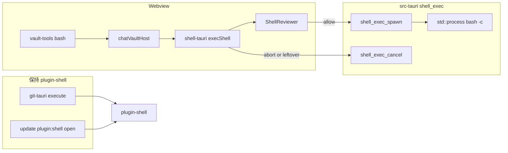
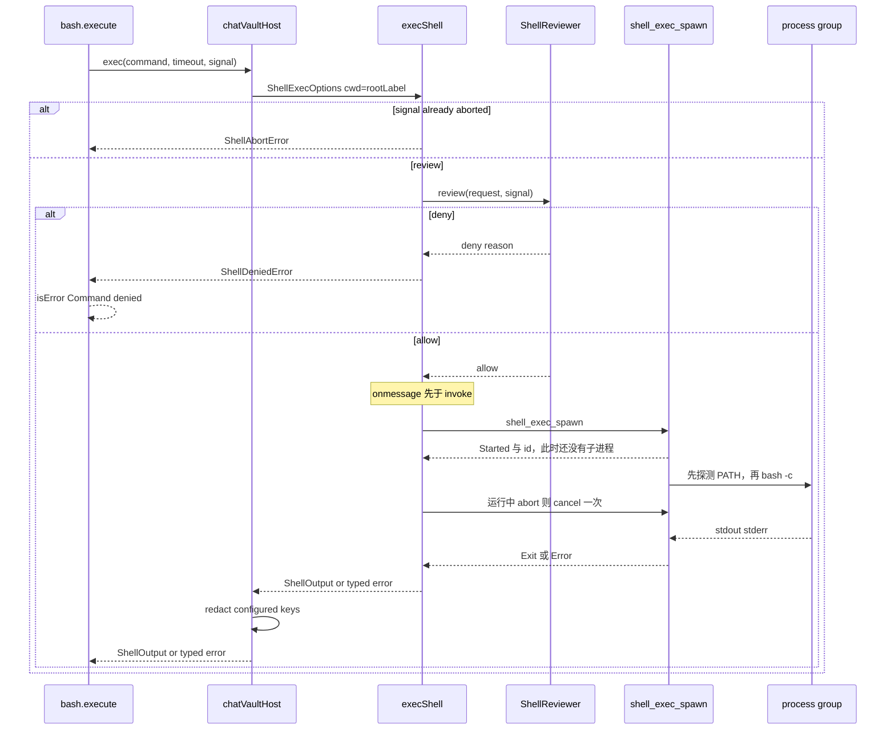

# 桌面端助手 shell：自建进程执行

> 状态：已确认，未开发
> 日期：2026-11-09
> 作者：待定
> 范围：`packages/platform`、`packages/core`、`packages/shell-tauri`、`apps/desktop/src/services/platform`、`apps/desktop/src/services/chat`、`apps/desktop/src-tauri`
> 不改：`packages/git-tauri`、`packages/shell-web` 的降级语义、助手工具名单与强力模式开关的产品含义

本文只定方案。方案已于 2026-11-09 确认，仍不写实现。

## 1. 背景与目标

助手的 `bash` 工具跑在 Tauri webview 的 JavaScript 里。`packages/core/src/agent-loop.ts` 的 `runAgentLoop` 用 `@earendil-works/pi-agent-core@1.1.0` 构造 `new Agent({ initialState.tools })`。该依赖不提供 bash 实现；本仓库的 `runAgentLoop` 也没有 `beforeToolCall`。真正执行命令的是 `packages/core/src/vault-tools.ts` 里的 `bash`，经 `VaultToolHost.shell.exec` 交给宿主。桌面宿主 `packages/shell-tauri/src/shell.ts` 再用 `@tauri-apps/plugin-shell` 的 `Command.create(program, ['-c', command], { cwd, env, processGroup: true }).spawn()` 拉起进程。

这条路径能跑，但控制点在插件里，不在我们手里：

- 能不能启动，由 capability 里的程序名白名单决定，不由我们的策略决定。`args: true` 等于 bash 的参数不做限制。
- 超时、中止、输出封顶都要再调插件的 `kill`。`capabilities/default.json` 有 `shell:allow-execute` 和 `shell:allow-spawn`，**没有** `shell:allow-kill`。插件命令受 ACL 约束（Tauri 2.12 `webview/mod.rs` 对 `plugin:` 命令一律检查）。因此发布包里 `child.kill()` 会被拒绝，超时、用户中止和 1MB 封顶都杀不掉进程。单测 mock 了插件，盖住了这个洞。
- stdout/stderr 按行推送（到 `\n` 或 `\r` 才出一个事件）。适配器再用 `appendChunk` 把行拼回去，无换行的输出要等下一行或进程结束。
- 子进程环境由插件解释：`env: None` 会 `env_clear()`，传入的 map 则是在父进程环境上 `envs` 合并（`tauri-plugin-shell` 2.5.0 `commands.rs` 的 `prepare_cmd`）。现在只为了覆盖 `PATH` 才走这条语义，以后想改环境没有干净的位置。
- 执行前没有拦截点。强力模式只决定工具挂不挂上（`toolsForAgentMode`），没有逐条命令的确认。

目标：进程由应用自己的 Tauri 命令用 `std::process` 拉起；`bash` 工具仍留在 webview。第一期行为与现在对齐（强力模式可用、默认直接执行、工作目录是 vault 根、登录 shell 的 PATH、同样的截断与错误类型）。接口上留出执行前的策略钩子，确认 UI 以后接到这个钩子上，而不是再改执行器。

## 2. 目标与非目标

**目标**

- 桌面端 `ShellBackend.exec` 不再调用 plugin-shell 的 spawn。
- Rust 侧负责：选定解释器、设置 cwd 与环境、新进程组、流式收集、超时、封顶、杀进程组、应用退出时回收。
- 策略接口在 spawn 之前运行。第一期默认放行，不弹窗。
- 拒绝、中止、超时仍以工具结果返回给模型（`isError: true`），不把 UI 放进 `@stride/core`。
- 浏览器继续「shell 不可用」，不造假实现。

**非目标**

- 不迁移 Git。`packages/git-tauri/src/git.ts` 的 `Command.create('git', args).execute()` 保持不动。
- 不改 `plugins.shell.open`。更新页仍调用 `plugin:shell|open`，配置仍是 `open: false`。
- 不解析 shell 语法去拦 `*.stride.json` 或其他文件。
- 不做 chroot、Seatbelt、容器或伪终端。不做命令输出的实时终端面板。
- 不把强力模式做进 Rust。模式仍由工具列表控制。
- 第一期不实现确认弹窗、危险命令分类、允许列表编辑器。
- 不改笔记文档结构，不把 shell 输出写进 vault。

没有新的落盘数据模型，也没有 vault / 设置 schema 迁移。

## 3. 现状（以仓库为准）

调用链：

```text
runAgentLoop
  → vaultTools() / toolsForAgentMode()     apps/desktop/src/services/chat/chat.service.ts
    → bash.execute                          packages/core/src/vault-tools.ts
      → host.shell.exec                    VaultToolHost.shell
        → chatVaultHost                     apps/desktop/src/services/chat/chat-vault-host.ts
          → resolveShellBackend()           apps/desktop/src/services/platform/shell.ts
            → shellBackend()                packages/shell-tauri/src/shell.ts
              → Command.spawn               @tauri-apps/plugin-shell
```

已核对的行为，实现时要保持，除非后文明确说改：

| 点 | 现在 |
|---|---|
| 工具是否暴露 | `bash` 在 `WRITE_VAULT_TOOLS`。`toolsForAgentMode(..., 'safe')` 去掉它；`'power'` 保留。模式写在 vault 的 agent 标志里，默认 `safe`（`VaultService.agentMode`）。 |
| 工作目录 | `chatVaultHost` 把 `vault.fs.rootLabel` 当作 `cwd`。桌面 `TauriFileSystem` 要求绝对路径。浏览器的 `rootLabel` 只是目录名，但浏览器走不到 exec。 |
| 解释器 | 用户命令按 `COMMAND_SHELLS`（`bash`、`zsh`、`sh`）尝试，只有解释器本身找不到才换下一个；退出码非 0 不换。登录 PATH 探测用 `LOGIN_SHELLS`（`zsh`、`bash`、`sh`）的 `-lic`，8 秒超时，哨兵 `__STRIDE_PATH__`。成功的 PATH 和成功的命令解释器都在 JS 里缓存。 |
| 用户命令的形态 | 解释器参数固定为 `['-c', command]`，不是登录 shell，也不会 source 用户的 rc。 |
| 环境 | 探测到 PATH 时只往子进程合并 `PATH`。父进程其余环境（`HOME`、`LANG`、`SSH_AUTH_SOCK` 等）保留。探测失败则不传 `env`，子进程继承父环境。 |
| 收集上限 | 适配器 `MAX_COLLECT_BYTES = 1MB`，超出则杀进程并 `truncated: true`。`code` 用插件 `close` 的 `payload.code`（SIGKILL 后多为 `null`）。stderr 再用 `appendChunk` 接上 `[output truncated]`，`formatShell` 另外加一行 `[Output truncated]`。`code === null` 在工具层是 `isError`（`Command terminated without an exit code`），不是退出码 0。工具再把给模型的文本裁到最后 2000 行或 50KB（`tailShell` / `formatShell`）。 |
| stdin | 插件 `Command::spawn` 建立 stdin 管道并握住写端，供 `plugin:shell\|stdin_write` 使用。capability 没有 `shell:allow-stdin-write`，JS 写不进去，但管道不关闭，`read` 会一直堵住，看不到 EOF。 |
| 超时 | 工具拒绝非有限、`<= 0` 或 `> 2147483.647` 秒的 timeout。不传则没有超时。现在的计时是 JS `setTimeout(timeoutSeconds * 1000)`，不取整。超时抛 `ShellTimeoutError`，`seconds` 用调用方传入的值，工具返回 `Command timed out after N seconds`。 |
| 中止 | `AbortSignal` 在启动前触发抛 `ShellAbortError` 且不 spawn。运行中触发则 kill，工具返回 `Command aborted`。 |
| 退出码 | `code === 0` 正常；非 0 是 `isError`，文案 `Command exited with code N`；`code === null` 也是 `isError`。 |
| 浏览器 | `browserShellBackend()` 返回 `unavailableShell()`。宿主再抛 `Shell is not available in the browser`。 |
| 提示词 | `VAULT_ASSISTANT_PROMPT` 和工具 description 要求用笔记工具改文档，不要用 shell 改写 `*.stride.json`。执行层不检查。 |

密钥：`runAgentLoop` 的 `summarize` 只用**当前这一轮的** `apiKey` 打码工具结果摘要的前 200 字，以及 provider 错误字符串（`redactSecret`）。完整工具结果、transcript、其他已配置的 key **不会**被这条路径打码。shell 输出今天原样回到模型。

自定义命令的 ACL 现状：`build.rs` 只有 `tauri_build::build()`，没有 `AppManifest::commands`。构建产物里应用 ACL 清单为空，`has_app_acl` 为 false。Tauri 2.12 因此**不检查**本应用自己的命令（`list_font_families`、`window_intent` 等），只检查插件命令，以及远程 origin。一旦 `build.rs` 登记了任何应用命令，`has_app_acl` 变 true，**所有**应用命令开始要 capability。这是第 10 节的约束，不是可选项。

`apps/desktop/CLAUDE.md` 写明不要在 `src-tauri/` 写笔记、Git 或密钥逻辑。本方案把进程生命周期放进 Rust，是对这条的窄例外：和 `fonts.rs` 一样，只做宿主能力。策略、打码、截断给模型的文本、确认 UI 都留在 TypeScript。Rust 不读 vault 业务、不接触 API key。

## 4. 目标架构



进程只在 `apps/desktop/src-tauri/src/shell_exec.rs` 里拉起。webview 里的 `bash` 仍是现在这个工具：校验参数、调用 `host.shell.exec`、`formatShell`、把退出码翻译成工具结果。它不变成 Rust，也不直接 `invoke`。

平行先例是字体：`packages/fs-tauri/src/fonts.ts` invoke `list_font_families`，实现在 `src-tauri/src/fonts.rs`。shell 同样拆开。适配器包继续只实现 `ShellBackend`，不引用 React，不引用 chat Service。



第一期 `review` 同步返回 allow，图上的 deny 分支只有测试会走到。确认 UI 以后只替换 `desktopShellReviewer.review`，不改 spawn 的参数和事件。直接 `invoke('shell_exec_spawn')` 不经过这张图里的 reviewer。

abort 与 `review()` 用 `Promise.race`（或等价物）。reviewer 如果忘掉 `signal`，停止生成仍然能在 spawn 之前结束等待，晚到的 allow 被丢掉，不会启动进程。

## 5. Rust 执行器

新文件 `apps/desktop/src-tauri/src/shell_exec.rs`。`main.rs` 在现有 `invoke_handler` 里加上这两个命令，并 `app.manage` 进程表。不要新建 crate，也不要做成 Tauri 插件。插件会把我们重新带进 plugin-shell 那套 scope。

### 5.1 命令

两条命令都是 `async fn`。参数是扁平的，不包一层 `request` 结构体。Tauri 2 的命令宏只把**参数名**改成 camelCase（`timeout_ms` → `timeoutMs`，`on_event` → `onEvent`）。嵌套结构体的字段不会自动改名，所以这里不使用嵌套结构体，避免线上键变成 `timeout_ms`。

```rust
#[tauri::command]
async fn shell_exec_spawn(
    webview: Webview, // Tauri 注入，不在 JS 载荷里
    command: String,
    cwd: String,
    timeout_ms: Option<f64>,
    on_event: Channel<ShellExecEvent>,
) -> Result<String, String>

#[tauri::command]
async fn shell_exec_cancel(id: String) -> Result<(), String>
```

JS 在 `invoke` 之前设置 `onmessage`。`Started` 可能早于 invoke 的 Promise resolve 到达，晚绑定会丢掉 id。

```ts
const onEvent = new Channel<ShellExecEvent>()
onEvent.onmessage = (event) => { /* 见下方 JSON */ }
const id = await invoke<string>('shell_exec_spawn', {
  command,
  cwd,
  timeoutMs, // 不传表示没有超时；不要传 program、args、env、webview
  onEvent,
})
```

`ShellExecEvent` 必须显式标注 serde。枚举默认是外部标签（`{"Stdout":{"data":"..."}}`），和下面的契约不是同一种。用内部标签，变体名 camelCase：

```rust
#[derive(Clone, Serialize)]
#[serde(tag = "event", rename_all = "camelCase")]
enum ShellExecEvent {
    Started { id: String },
    Stdout { data: String },
    Stderr { data: String },
    Exit { code: Option<i32>, truncated: bool, reason: String },
    Error { message: String },
}
```

线上 JSON 只有这五种，`reason` 只取 `exit`、`timeout`、`cancel`、`cap`：

```json
{"event":"started","id":"7f0c..."}
{"event":"stdout","data":"hi"}
{"event":"stderr","data":"warn"}
{"event":"exit","code":null,"truncated":true,"reason":"cap"}
{"event":"error","message":"No shell is available"}
```

id 在**任何子进程之前**就放进进程表，记下 `webview.label()`，并通过 `Started` 和 invoke 的返回值交出去。登录 PATH 探测和用户命令都还没开始。这样取消能打到探测阶段。id 是 128 位随机值，不用递增整数。

invoke 返回前的校验失败（空命令、cwd 不合法、超过 256KB、并发已满）是 `Err`，不发事件。id 已经返回之后，任何结局都要再发一条 `Exit` 或 `Error`，包括 `killpg` / `TerminateJobObject` 失败：失败先 `eprintln!`（第 14 节），然后如果 `wait` 有状态就发 `Exit`，否则发 `Error`。不允许只打日志就让 Channel 静默结束。

JS 看不到 Channel 关闭，适配器也不要去看。`@tauri-apps/api` 2.12 的 `Channel` 没有 `onclose`。Rust 在最后一个 `Channel` clone 丢掉时 eval `{ end: true, index }`（`tauri` 2.12.3 `JavaScriptChannelId::channel_on` 的 `on_drop`）。JS 在私有回调里看到 `'end' in rawMessage` 就 `cleanupCallback` 或记下 `messageEndIndex`，然后 return，不调用 `onmessage`。不要读这个私有帧，也不要钩 `__TAURI_INTERNALS__`。`onmessage` 只在 `Exit` 或 `Error` 上结束这条 exec。

`Channel` 通过 `Arc` 克隆，结束帧要等最后一个 clone 丢掉才发。一个会话对象独占这份 `Channel`。读管道的任务不能再留一份活过会话的 clone。会话丢掉时如果还没发过终结事件，先 `send` 一条 `Error`，`message` 固定为 `shell session ended`，不含命令正文，也不含 stdout；然后再丢掉 `Channel`。读者正常返回或 panic 都要把会话从表里拿掉，这样 `Drop` 才会跑。调试构建的 panic 是 unwind（`panic = "abort"` 只在 release profile），不发这条 `Error` 的话，同一页上的 Promise 会一直挂着，应用却还在。随后的结束帧改不了结果：第 5.5 节第 8 步已经在 settle 时摘掉监听，而且结束帧本来就不会进 `onmessage`。

`shell_exec_cancel`：未知 id 返回 Ok，重复 cancel 也是 Ok。它打断当前阶段（探测或用户进程），探测被取消时不写入 PATH 缓存，也不再启动 `bash -c`。用户命令的 `timeout_ms` 从用户进程 spawn 成功起算，不是从 id 分配起算。

JS 不传 `program`、`args`、`env`。这三样由 Rust 决定。否则 webview 可以绕过「只跑 `bash -c`」。这并不等于 reviewer 盖住了所有 spawn：直接 `invoke('shell_exec_spawn')` 不经过 `ShellReviewer`，见第 9.4 节。

模块是 `#[cfg(desktop)] mod shell_exec;`，和 `fonts` 一样。命令只注册在 `main.rs` 已有的 `#[cfg(desktop)]` `invoke_handler` 里。进程表放在 `app.manage` 的状态里，用 `Mutex` 保护。锁只覆盖表的插入、取出和阶段标记，不覆盖 `wait`、读管道或 `kill`。探测、读管道和 `wait` 放到 `tauri::async_runtime::spawn_blocking`（或等价的 std 线程）。不要把最长 8 秒的登录探测写在会占住运行时 worker 的同步命令体里；`list_font_families` 已经用 `spawn_blocking`，同一理由。

JS 丢掉 `Channel` 对象不会注销回调，下一次 `send` 也不会因此变成 `Err`。每条事件序列化后的 JSON 必须严格短于 8192 字节。这是 Tauri 2.12.3 的 `MAX_JSON_DIRECT_EXECUTE_THRESHOLD`，直接 eval 的条件是 `json_string.len() < 8192`。达到或超过这个长度会走 fetch 队列：webview 已经不在时 `insert_if` 得到 `None`，`channel_on` 仍返回 `Ok(())` 并丢掉正文。所以一次大事件的 `Ok` 不能当成「webview 还在」。管道最多读 4KB。包上 `{"event":"stdout","data":...}` 之后，若转义使 JSON 达到 8192，把这块再拆开重发，直到每一条都落在直接 eval 路径上。这个上限只让 `send` 留在直接 eval 路径上，它不是重载信号。

webview 重载也不是 `send() == Err`。`Cargo.toml` 里 `tauri` 的 features 是空的，没有 `tracing`，所以 `eval_script` 是非 tracing 的那一版：`Context::send_user_message`。代理还在时它返回 `Ok(())`，只有代理本身没了才是 `FailedToSendMessage`，那已经是进程退出。事件循环里的 `EvaluateScript` 若 `evaluate_script` 失败，只 `log::error!`，不把错误送回 `send`。webview 句柄已经不在时，这条消息被丢掉，`send_user_message` 仍然是 `Ok`。`Webview::is_registered` 是 `pub(crate)`，执行器不能拿它当信号。因此没有超时的 `sleep` 在重载之后不会因为 `send` 失败而腾出表项。

`send` 若真的返回 `Err`，同一次失败只再尝试一条 `shell session ended`。这一条也是 `Err` 就停，不要再发，也不要假装 JS 看见了关闭。无论这条是 `Ok` 还是 `Err`，都记成已经发过终结事件，会话的 `Drop` 不要再发第二条。不要把这次 `Err` 写成重载回收。

重载和关窗的回收用 `main.rs` 里已经注册的回调，按会话上保存的 `webview.label()` 匹配。只取消这个 label 的会话，别的窗口继续跑。取消的动作和 `shell_exec_cancel` 一样：打断当前阶段，探测被取消时不写入 PATH 缓存，也不再启动 `bash -c`，然后把会话从表里拿掉，让 `Drop` 去发那一条 `shell session ended`。

- `on_page_load` 已经注册。现在 macOS 上只在 `PageLoadEvent::Finished` 时 `frame::kick`，非 macOS 把 `webview` 和 `payload` 丢掉。在同一个回调里增加 `PageLoadEvent::Started`：label 相同就取消那些会话。这段不能包进 `target_os = "macos"`，Finished 的 kick 保持原样。文档重载会发出 Started（wry 把 `PageLoadEvent::Started` 转成 Tauri 的同名事件）。Vite 的客户端路由不加载新文档，不会发这个事件。
- `on_window_event` 已经在 `#[cfg(desktop)]` 里对 `WindowEvent::Destroyed` 调用 `windows::forget_window(window.label())`。同一分支再取消这个 label 的会话。关掉一个窗口不是 `RunEvent::Exit`，其他窗口还开着。本应用的窗口来自 `WebviewWindowBuilder`（`main` 或 `winN`），`window.label()` 就是会话里存的 webview label。
- `RunEvent::Exit` 杀掉全部会话。现有 `run` 回调只在 macOS 上处理 `Reopen`。shell 的退出回收加在这个回调里，所有桌面平台都要执行，不要写进 `Reopen` 分支。不依赖 `Drop` 顺序去覆盖应用退出。

### 5.2 解释器与 PATH

两套查找，和现在的分工一致，只是从插件的程序名白名单改成我们自己的路径查找。

| 用途 | 顺序 | 参数 | 环境 |
|---|---|---|---|
| 登录 PATH 探测 | zsh，bash，sh | 见下面的 argv 字节 | 不覆盖 PATH。超时 8 秒。 |
| 用户命令 | bash，zsh，sh | `["-c", command]`，`command` 是用户字符串本身 | 探测成功则覆盖子进程 `PATH`，否则继承 |

探测的 argv 是两段。第一段是 `-lic`。第二段必须等于今天 `shell.ts` 这句求值后的字符串：

```ts
`printf '\\n${SENTINEL}%s' "$PATH"`
```

`SENTINEL` 是 `__STRIDE_PATH__`。求值结果的字符是：

```text
printf '\n__STRIDE_PATH__%s' "$PATH"
```

其中引号后的 `\n` 是两个字节 `0x5C 0x6E`（反斜杠和字母 n），不是换行 `0x0A`。shell 把单引号里的内容原样交给 `printf`，由 `printf` 把 `\n` 打成换行。写 Rust 时用普通字符串 `"printf '\\n__STRIDE_PATH__%s' \"$PATH\""`。不要写进 raw string，也不要再加一层反斜杠，否则探测去找字面量 `\n` 和带引号的 `$PATH`，哨兵匹配失败，命令会静默继承父进程 PATH。从 Finder 启动时那份 PATH 是 `/usr/bin:/bin:/usr/sbin:/sbin`，Homebrew 里的工具就会消失，而且一旦被错误缓存就会留住整个进程。

解析和 `readPath` 相同，对每一个登录 shell 按顺序做：

- 退出码不是 0：换下一个登录 shell。
- 在 `stdout + "\n" + stderr` 里找**最后一个** `__STRIDE_PATH__`。没有哨兵：换下一个。
- 哨兵之后 `trim`，再按 `/\r?\n/` 取第一行，再 `trim`。空字符串：换下一个。
- 得到非空 PATH 才缓存。非 0、没有哨兵、空 PATH、探测超时或被 cancel，都不缓存。

因此是「每个进程最多一次成功的探测」，不是「只探一次」。今天的 `pathCache` 会把「全部失败、结果是 `undefined`」也缓存住；这里故意不缓存失败，下一条用户命令可以再探。cancel 掉探测时清掉这次未完成的结果，并且不启动 `bash -c`。用户命令的超时不包含这 8 秒。探测不经过 `ShellReviewer`，也不出现在 `bash` 工具调用里。

查找解释器：沿**父进程**的 `PATH`，再加固定目录 `/bin`、`/usr/bin`、`/usr/local/bin`。命中第一个可执行文件。macOS 上从 Finder 启动时父 PATH 通常是 `/usr/bin:/bin:/usr/sbin:/sbin`，所以解释器是系统 bash，不是 Homebrew bash。这和今天 plugin-shell 用父 PATH 解析程序名、再用登录 PATH 作为**子进程环境**的结果一致。不要把登录 PATH 用于查找解释器，否则会悄悄改成 Bash 4/5。

用户命令只在「解释器文件不存在或 `spawn` 返回 `NotFound`」时换下一个解释器。退出码非 0 是用户命令的结果，不换解释器。解释器缓存对齐今天的 `commandShell`：只在这次用户命令以 `ShellOutput` 返回时写入，也就是 `Exit` 的 `reason` 为 `exit` 或 `cap`。`timeout`、`cancel`、`Error`、`NotFound` 都不写入。不要在 `spawn` 成功的瞬间缓存。今天第一次命令若超时或中止，`run()` 抛错，`commandShell` 不会被赋值；提前缓存会把还没跑完的解释器钉死。

Windows：同样先找 `bash.exe` / `zsh.exe` / `sh.exe`（父 PATH，外加 `ProgramFiles\Git\bin` 与 `ProgramFiles(x86)\Git\bin`）。找不到就返回明确错误 `No shell is available`，映射到现有的抛错，而不是退到 `cmd` 或 PowerShell。工具契约是 bash。

### 5.3 cwd

Rust 在 spawn 前检查：

- 非空，不含 NUL。
- 绝对路径。相对路径直接拒绝，不相对应用的当前目录解析。桌面 vault 的 `rootLabel` 已是绝对路径；相对路径只可能是宿主 bug 或 webview 乱传。
- `canonicalize` 成功，且结果是目录。检查用规范路径，**交给子进程的 cwd 仍是宿主传入的原始字符串**，这样 vault 根是符号链接时 `pwd` 不变。
- 不要求位于 `$HOME` 之下。vault 可以在外置卷上。`TauriFileSystem` 只要求绝对路径，这里对齐。

不维护一份 Rust 侧的「已打开 vault」白名单。vault 是 JS 用 plugin-fs 打开的，同一 webview 若能调用 spawn，也就能谎报另一个绝对路径。产品上的 cwd 来源仍是 `chatVaultHost` 的 `vault.fs.rootLabel`。见第 9 节。

### 5.4 环境、进程组、回收

子进程环境 = 父进程环境的拷贝。探测成功时只改 `PATH`。不清环境。不从 JS 接收额外变量，因此 webview 不能设 `LD_PRELOAD`、`BASH_ENV` 或 `DYLD_*`。

stdin 使用 `Stdio::null()`。这是有意的行为变化，不是维持现状。今天插件把 stdin 接在一根打开的管道上，写端握在 `CommandChild` 里；没有 `shell:allow-stdin-write` 时 JS 不能写，但 `read` 也不会看到 EOF，而是一直堵住。`Stdio::null()` 让 `read` 和交互式提示立刻得到 EOF，并且 `pnpm tauri dev` 挂在终端上时不会把那个终端的 stdin 继承进命令。不建管道，也不提供 stdin 写入命令。

Unix：`CommandExt::process_group(0)`，子进程成为组长。杀死时 `killpg(pid, SIGKILL)`，再 `wait`。组长已退出但子孙还在时仍然 `killpg`（与 plugin-shell 2.5.0 `CommandChild::kill` 的注释一致）。`ESRCH` 视为已经没了。直接依赖 `libc` 的 `killpg`，不引入 `nix`，除非实现时发现 `libc` 不够。

Windows：顺序是强制的，和插件 `process/mod.rs` 一样，但不把 `job_object.rs` 拷进仓库。`CREATE_SUSPENDED | CREATE_NO_WINDOW` 创建子进程，`AssignProcessToJobObject`，然后恢复线程。`std::process` 在 `CreateProcess` 之后关掉主线程句柄，不能对创建时的句柄调用 `ResumeThread`。恢复方式和插件 `job_object.rs` 的注释相同：`CreateToolhelp32Snapshot` 列出该 pid 的线程，`OpenThread` 再 `ResumeThread`。先普通 `spawn` 再挂 job 会漏掉 `bash -c` 已经拉起来的孙子进程。挂 job 失败时杀掉仍处于挂起的子进程，不要留在外面。cancel、超时、封顶和应用退出都 `TerminateJobObject`。直接依赖 `windows-sys` 里 job、toolhelp 与线程恢复所需的 feature。`libc` 与 `windows-sys` 都按目标平台写进 `Cargo.toml`，不要做成无条件依赖。

上限：

- 命令字符串最长 256KB（UTF-8 字节），超出在 id 分配前拒绝。
- 同时占着进程表的条目最多 8 个（含尚未结束的探测，以及已经分配 id 但还没 spawn 的占位）。超出拒绝，文案 `too many shell processes`。助手工具执行是 `toolExecution: 'sequential'`，正常只有 1 条用户命令。上限是为了挡住 webview 直接 invoke。
- stdout+stderr 合计 1MB（`MAX_COLLECT_BYTES`，按字节计，与现在的 `TextEncoder` 口径一致）。达到后停止读取并杀进程组。
- 管道按最多 4KB 的块读。不完整的 UTF-8 序列留到下一块。非法序列用替换字符。发出去的每一条事件，序列化 JSON 必须短于 8192 字节；转义超限就再拆，见第 5.1 节。Channel 上是原始解码文本，**不再按行切**。适配器把块直接拼接。`appendChunk` 删除，因为它会在原始块中间插入换行。

封顶的 `Exit` 不是把命令报成成功。`code` 用 `wait` 的状态：SIGKILL 之后通常是 `null`，不要改成 0。`truncated` 为 true。适配器把这个 `Exit` **resolve** 成 `ShellOutput`（不抛 `ShellAbortError` / `ShellTimeoutError`），并在 stderr 上保留今天的后缀：若还没有，就按 `appendChunk` 的换行规则接上 `[output truncated]`。`formatShell` 仍会再加一行 `[Output truncated]`。工具层继续用第 3 节的退出码规则，所以 `code === null` 仍是 `isError` 的 `Command terminated without an exit code`。2000 行 / 50KB 的尾部裁剪不变。

reason 的优先级：`cancel` 高于 `timeout`，高于 `cap`，高于自然 `exit`。abort 或超时已经提出时，封顶只把 `truncated` 留成 true，不把 reason 改成 `cap`。封顶先发生则 reason 保持 `cap`，即使 `code` 是 null。其后的 cancel 升级为 `cancel`，`truncated` 仍为 true。同时到达时按这个顺序，不要让后写的状态覆盖先写的 cancel。

超时由 Rust 计时，时钟从**用户进程** spawn 成功开始，不是从 id 分配或 PATH 探测开始。到点则 `reason: "timeout"`。不要在 JS 再挂一个并行定时器。传给 Rust 的 `timeoutMs` 就是 `timeoutSeconds * 1000` 这个数字，不 `Math.round`，也不抬到至少 1。Rust 用 `Duration::from_secs_f64(timeout_ms / 1000.0)`。适配器构造 `ShellTimeoutError` 时仍用调用方原来的 `timeoutSeconds`，工具文案里的秒数不变。今天的 `setTimeout(timeoutSeconds * 1000)` 同样不取整；取整会让 `0.02` 以外的小数秒和现在差出 1 毫秒。

`reason: "cancel"` 映射为 `ShellAbortError`，`output` 带上已经收到的 stdout/stderr。`reason: "exit"` 和 `reason: "cap"` 都映射为 resolve 的 `ShellOutput`。`Error` 事件和 invoke 的 `Err` 作为普通 `Error` 抛出。`onmessage` 不等 Channel 结束帧，也没有 `onclose`。`vault-tools.ts` 里现有的 `throw error` 分支接住，不新增第四种工具文案。

应用 `RunEvent::Exit` 时杀光进程表里的组，与 plugin-shell 在退出时 kill children 相同。加在现有 `main.rs` 的 `run` 回调里，所有桌面平台都执行，不要写进 macOS 的 `Reopen` 分支，也不依赖 `Drop` 顺序。这只覆盖应用退出。文档重载走 `PageLoadEvent::Started`，关掉一个窗口走 `WindowEvent::Destroyed`，都只取消该 label 的会话。二者都不是 `send() == Err`，见第 5.1 节。

### 5.5 适配器怎么接

`packages/shell-tauri/src/shell.ts` 删掉 `@tauri-apps/plugin-shell`。改为 `@tauri-apps/api` 的 `invoke` 与 `Channel`（桌面端已有这个依赖，适配器包目前没有，要加）。`package.json` 去掉 plugin-shell。

`resetShellSessionForTests` 只被本包测试使用。PATH 和解释器缓存挪到 Rust 之后删掉这个导出。JS 测试 mock `invoke`，不需要清 Rust 缓存。

`execShell` 从调用 `review` 之前就开始听 `signal`，一直听到 `Exit`、`Error`、deny，或 spawn 之前的 abort。步骤：

1. 空命令、空 cwd：仍抛现在这两句 `Command is empty` / `Working directory is empty`。不 review，不 invoke。
2. `signal` 已经 aborted：`ShellAbortError`，不 review，不 invoke。
3. `Promise.race`：`reviewer.review(request, signal)` 对一个 abort Promise。abort 先到则 `ShellAbortError`，丢掉稍后才 resolve 的 allow 或 deny，不 invoke。reviewer 自己忘了看 `signal` 也不能把 `bash.execute` 留到 60 秒确认超时。
4. review resolve 为 deny：`ShellDeniedError`，不 invoke。reason 裁到 200 字符并去掉控制字符。
5. 再看一次 `signal`。然后创建 `Channel`，**先**赋 `onmessage`，**再** `invoke('shell_exec_spawn', ...)`。
6. 记下 `Started` 的 id（或 invoke 返回的同一个 id）。在 id 已知之后，第一次 abort 调用 `shell_exec_cancel` **恰好一次**。id 到达之前已经 abort 的，也在拿到 id 的同一刻 cancel，不让探测或 `bash -c` 跑下去。
7. 拼接 stdout/stderr，直到 `Exit` 或 `Error`。按第 5.4 节映射类型。封顶时补上 stderr 的 `[output truncated]` 后缀。
8. 监听在 settle 时摘掉。cancel 之后继续等到 `Exit` 或 `Error`，不要在 `shell_exec_cancel` 返回时就自己造一个空的 `ShellAbortError`。`onmessage` 只认这两种事件。不要把 `{ end: true }` 当成关闭，settle 之后到达的结束帧也不能改结果。

浏览器包不走这条 invoke。`resolveShellBackend` 在非桌面运行时仍返回 `browserShellBackend()`。

这套监听和「id 早于探测」属于 spawn 协议，做在 PR 2 / PR 3。PR 5 的确认框只替换 `desktopShellReviewer.review`，不再改 id、Channel 或 cancel 的时机。

## 6. 和继续用 plugin-shell 的差别

| | plugin-shell spawn（现在） | 自建命令（本方案） |
|---|---|---|
| 谁能跑 | capability 里的 `bash`/`zsh`/`sh`/`git`，`args: true` | 只有 `shell_exec_spawn`。参数里没有程序名。argv 固定 `-c` |
| 杀进程 | 另一个命令 `plugin:shell\|kill`，要 `shell:allow-kill`，当前没授 | `shell_exec_cancel` 在进程内 `killpg` / Job。不依赖插件 kill |
| PATH | JS 先 spawn 一次登录 shell，再把 PATH 塞进插件的 env map | Rust 内探测并缓存。探测不经过策略钩子 |
| cwd | 插件原样收下，不检查是否绝对、是否存在 | 绝对路径、存在、是目录。符号链接保留调用方路径 |
| 环境 | JS 能传任意 env；`null` 会清空 | JS 不能传 env。只覆盖 PATH |
| 输出 | 按行，适配器再拼回去 | 最多 4KB 的原始块，直接拼接。单条事件 JSON 短于 8192 字节。封顶时适配器仍往 stderr 接 `[output truncated]` |
| stdin | 打开的管道，JS 写不了，读端也不到 EOF | `Stdio::null()`，读到的是立即 EOF |
| 超时 | JS `setTimeout(timeoutSeconds * 1000)` 再 kill；kill 在发布包里实际失败 | Rust 用同一个毫秒数计时并杀组，不取整 |
| 封顶 | JS 计字节再 kill，`code` 为 wait 状态 | Rust 停读并杀组。promise resolve，`code` 仍是 wait 状态，不强制为 0 |
| 执行前拦截 | 没有。scope 只匹配程序名 | `ShellReviewer` 只包住适配器里的 `exec`。直接 invoke 新命令不经过它 |
| 退出回收 | 插件在 `RunEvent::Exit` 杀自己的表 | `RunEvent::Exit` 杀全部会话。文档重载用已有 `on_page_load` 的 `PageLoadEvent::Started`，关窗用已有 `on_window_event` 的 `WindowEvent::Destroyed`，都只取消该 label。重载不是 `send() == Err` |

Git 用的是 `execute`，不是 `spawn`。上表不描述 Git。

## 7. Git 继续用 plugin-shell

决定：`packages/git-tauri` 不动。

理由：Git 的 argv 是我们自己拼的（`status`、`commit`、`push` 等），不是模型给的字符串。它不需要流式输出、进程组、登录 PATH 或执行前确认。`execute` 一次拿回 stdout/stderr/code，`GIT_ENV` 只合并 `GIT_MERGE_AUTOEDIT`、`GIT_TERMINAL_PROMPT`、`LC_ALL`。这条路径不依赖 `shell:allow-spawn`，也不依赖缺失的 `shell:allow-kill`。

把它迁到 `shell_exec_spawn` 会让笔记应用的 Git 状态机和助手 shell 绑在同一个命令上：助手侧的超时、1MB 封顶、策略钩子、`bash -c` 都会变成 Git 的语义。没有证据表明留着 Git 会挡住「可控执行」或「以后能确认」。统一本身不是目标。

因此 capability 里 `shell:allow-execute` 的 `git` / `args: true` **保持原样**，包括不收紧 git 的参数。收紧会碰 `git.service` 的每一条子命令，和这次无关。

## 8. 端口与执行前拦截

UI 不进入 `@stride/core`，也不进入 `ShellBackend` 的方法签名。core 的 `bash` 仍然只调用 `host.shell.exec`。拦截放在适配器的 `exec` 里面，由桌面在构造后端时注入。

`packages/platform/src/shell.ts` 增加：

```ts
export interface ShellReviewRequest {
  command: string
  cwd: string
  timeoutSeconds?: number
}

export type ShellReview =
  | { action: 'allow' }
  | { action: 'deny'; reason: string }

export interface ShellReviewer {
  review(request: ShellReviewRequest, signal?: AbortSignal): Promise<ShellReview>
}

export function allowAllShellReviewer(): ShellReviewer {
  return { review: () => Promise.resolve({ action: 'allow' }) }
}

export class ShellDeniedError extends Error {
  readonly reason: string
  constructor(reason: string) {
    super(`denied:${reason}`)
    this.name = 'ShellDeniedError'
    this.reason = reason
  }
}
```

`ShellBackend`、`ShellExecOptions`、`ShellOutput` 的字段不改。`MemoryShell` 不长出 reviewer：工具测试打的是 host 假对象，不是适配器。`shellBackend(options?: { reviewer?: ShellReviewer })` 缺省用 `allowAllShellReviewer()`，避免调用方漏传时 bash 失效。

桌面注入点是 `resolveShellBackend`，后端单例只建一次：

```ts
// apps/desktop/src/services/platform/shell-review.ts
export const desktopShellReviewer: ShellReviewer = {
  review() {
    return Promise.resolve({ action: 'allow' })
  },
}
```

`review` 每次现读策略，不要把「允许」拷进闭包。第一期函数体就是放行。以后确认 UI 改这个对象的方法，去读一个 Service 的 pending promise。不要在第一期注册空的 rabjs Service。

`packages/core` 只认识 `ShellDeniedError`，不认识弹窗。`bash.execute` 在现有 `ShellAbortError` / `ShellTimeoutError` 旁增加：

```ts
if (error instanceof ShellDeniedError) {
  const reason = error.reason.trim() || 'denied'
  return { ...toolText(`Command denied: ${reason}`, { denied: true }), isError: true }
}
```

拒绝发生在 spawn 之前，没有 stdout/stderr。不要走 `formatShell` 的空输出，否则模型会看到一句多余的 `(no output)`。reason 由适配器裁到 200 字符，去掉控制字符。工具文案保持英文，与现有的 `Command aborted` / `Command timed out after ...` 一致；这些是给模型的工具结果，不是 i18n 目录里的界面句。确认弹窗如果以后出现，那个弹窗的句子才进 `en.ts` / `zh.ts`。

以后确认接上时的契约（第一期不实现，但错误类型和工具分支现在就在，避免第二期改 core 的返回形态）：

| 事件 | 谁做 | 进程 | 工具结果 |
|---|---|---|---|
| 默认，或策略放行 | `desktopShellReviewer` | 照常 spawn | 与今天相同 |
| 用户拒绝 | 未来的 reviewer resolve `{ action: 'deny', reason }` | 不 spawn | `isError`，`Command denied: ...`，`details.denied = true` |
| 等待确认超时 | reviewer 自己计时，按拒绝处理。已定为 60 秒，reason 固定 `confirmation timed out` | 不 spawn | 同上 |
| 等待期间用户停止生成 | 适配器 `Promise.race` 掉 `review()` 与 `signal`。reviewer 忘掉 signal 也不能 spawn | 不 spawn | 现有的 `Command aborted`，`details.aborted = true`。不是 deny |
| 命令本身的 timeout | Rust，从 spawn 成功起算 | 杀组 | 现有的 `ShellTimeoutError`。**不含**确认等待 |

确认等待阻塞的是 `bash.execute` 的 Promise。`runAgentLoop` 已是 `toolExecution: 'sequential'`，模型会停在这条工具上直到 review settle。不需要新的并发模型。命令超时的时钟在 spawn 之后才走，否则 5 秒的命令超时会在确认对话框上先到期。

确认界面的形态已在 2026-11-09 定下，第一期仍不写。以后做时用 `ui/primitives/modal.tsx`，挂在聊天面板上，禁止 `window.confirm`。只问被标成危险的命令，普通命令直接放行。状态放桌面 Service，不放 core，不放 shell-tauri。shell-tauri 只调用 `ShellReviewer` 接口。

## 9. 安全边界

### 9.1 cwd 与 `cd`

初始 cwd 锁定为宿主传来的绝对路径，生产路径上就是当前 vault 根。这只约束进程**启动时**的目录。

`bash -c` 里的 `cd`、绝对路径、`~` 都可以离开 vault。第一期不禁止。原因：

- 助手要用 vault 外的 `git`、`node`、hook 里调用的解释器。这些二进制本来就不在 vault 里。
- 拦 `cd` 或拦「跑到 home 之外」都要解析 shell，而且拦不住 `python -c`、重定向和 `env`。做成半套检查会给人一种已经沙箱化的错觉。
- vault 不保证在 `$HOME` 下面。把「必须在 home 内」写成规则会拒绝外置磁盘上的 vault，同时仍然拦不住 `cd "$HOME"`。

真正的产品闸门仍是强力模式：安全模式根本不挂 `bash`。见 9.4 的残余风险。

### 9.2 命令字符串原样交给 `bash -c`

用户字符串是 `-c` 的**一个**参数，不再经过一层外壳。因此 JS 字符串拼接不会额外引入引号注入。风险是模型（或笔记里的提示注入）让工具去跑破坏性命令：`rm`、`curl | sh`、改 hook、读 `~/.ssh`。这是强力模式的既定能力，不是实现疏漏。

第一期不做：

- 元字符黑名单、命令前缀白名单。
- 对 `*.stride.json` 的正则拦截。提示词里那句保持原文，执行层不增加检查。`bash -c 'python -c "open(\"x.stride.json\",\"w\").write(...)'` 一类绕过会使检查变成假安全，还可能误伤 `rg`、`git diff`、`cat`。
- 事后对照文件系统做「是否改了笔记」的扫描。那是另一个功能。

笔记仍只能通过笔记工具结构化修改。shell 改坏了 JSON，现有的解析失败路径会表现出来，本方案不新增修复逻辑。

### 9.3 输出与密钥

Rust 看不到 API key，也不记录命令正文和 stdout/stderr。

打码放在 `chatVaultHost` 的 `shell.exec` 返回之后、进入 core 之前。密钥来自 `SettingsService` 上的新方法 `configuredSecretValues()`：每个 llm 配置的 `llmRuntime(id).apiKey`，再加上 `embeddingRuntime().apiKey`，丢掉空串。这就是今天 `chat-memory-host.ts` 里 `secretValues()` 的那段遍历。`secretValues()` 改为调用这个方法，不留第二份。打码前把密钥拷一份，按 `secret.length` 从长到短排序，再逐个 `redactSecret`（整段替换成 `••••`）。先替换短 key 会把长 key 拆开，长的那段就再也匹配不到。排序只用于打码的这份拷贝。`configuredSecretValues()` 和 `secretValues()` 仍按现在的顺序返回：llm 配置在前，embedding 在后。不要让打码排序改掉记忆宿主的返回值。

只捕获 `ShellAbortError` 和 `ShellTimeoutError`。用打码后的 `stdout`/`stderr` 构造**同一个类**的新实例再抛（`ShellTimeoutError` 原样带上 `seconds`）。`output` 是 `readonly`，不要改成普通 `Error`，也不要去改 `message`。`ShellDeniedError` 没有输出，和其他错误一样原样再抛。`bash.execute` 靠 `instanceof` 分支，包一层 `new Error` 会掉进 `throw error`，确认拒绝和中止的工具文案就没了。

这比 agent loop 现状更严，而且必须做在宿主：loop 只打码当前 key 的 200 字摘要，工具正文会进模型上下文和会话 transcript。打码放在 host，core 的 `MemoryShell` 测试不用碰密钥，Rust 也不碰密钥。

不打码的残余：工具参数里的 `command` 字符串若本身含 key，仍会留在 transcript 的 tool call 里。那是所有工具共有的，不在这次单独处理。过短的 key 可能误伤普通输出，与 `redactSecret` 今天的行为一致，不另加最短长度。

### 9.4 强力模式不是 OS 边界

`shell_exec_spawn` 一旦出现在 capability 里，本地 webview 的任意 JS 都能调用，不看 `agentMode`。这和今天 capability 对 `bash` `args: true` 相同，也和 `fs:scope **` 相同。Rust 不去读 `.stride/vault.json` 判断模式——那会把 vault 业务写进 `src-tauri`，而且同一 webview 仍能伪造。

`ShellReviewer` 只存在于适配器的 `execShell`。PR 2 就把命令放进 capability，那时还没有 reviewer；PR 3 之后直接 `invoke('shell_exec_spawn')` 仍然不经过它。不要把这条旁路写成「闸门盖住了唯一的 spawn 路径」。以后的确认 UI 只替换 `desktopShellReviewer.review`。把检查搬进 Rust 是另一份设计，不在这次的协议里。

接受这个残余风险。收紧它不属于第一期。不要用「安全模式没挂工具」来描述操作系统级隔离。

### 9.5 浏览器

`packages/shell-web` 继续返回 `unavailableShell()`。不要用 WASM、远程代理或「只回放 MemoryShell」假装浏览器能跑命令。`isDesktopRuntime()` 为 false 时 `resolveShellBackend` 不 import `@stride/shell-tauri`。

## 10. 能力清单

### 10.1 应用自己的命令

`apps/desktop/src-tauri/build.rs` 改为登记命令，否则新命令没有 allow 权限文件，而且一旦登记就会打开应用 ACL：

```rust
fn main() {
    let attributes = tauri_build::Attributes::new().app_manifest(
        tauri_build::AppManifest::new().commands(&[
            "window_intent",
            "window_set_project",
            "menu_new_window",
            "menu_new_project",
            "menu_open_project",
            "sync_recent_projects",
            "list_font_families",
            "shell_exec_spawn",
            "shell_exec_cancel",
        ]),
    );
    // try_build 失败时返回 Err，不会自己退出。build() 才会在错误时 exit 1。
    // 丢掉 Result 会让 Cargo 以为脚本成功，应用 ACL 可能半开。
    tauri_build::try_build(attributes).expect("failed to run tauri-build");
}
```

同一 PR 的 `capabilities/default.json` 必须同时加入对应的 `allow-<kebab-name>`（下划线换成连字符，这是 `tauri-build` 2.7 的生成规则）：

- 已有命令：`allow-window-intent`、`allow-window-set-project`、`allow-menu-new-window`、`allow-menu-new-project`、`allow-menu-open-project`、`allow-sync-recent-projects`、`allow-list-font-families`
- 新命令：`allow-shell-exec-spawn`、`allow-shell-exec-cancel`

漏掉已有命令的 allow，发布包里字体列表和窗口意图会变成 `Command ... not allowed by ACL`。调试包则会在拒绝信息里写原因。这是 Tauri 2.12 的行为，不是推测。

`permissions/autogenerated/` 由 build.rs 写到源码树，加入 `.gitignore`，不提交。`apps/desktop/src-tauri/gen/schemas/` 今天是提交的；改 capability 后把重新生成的 schema diff 一并提交。

不添加一个「允许全部应用命令」的 default permission。新命令必须显式出现在 `build.rs` 和 capability 里。

### 10.2 plugin-shell 留什么、删什么

切换适配器的那个 PR（见 PR 3）改 `capabilities/default.json`：

| 权限 | 决定 |
|---|---|
| `shell:allow-execute` 的 `git`，`args: true` | **保留**。Git 仍用 `execute`。 |
| `shell:allow-execute` 的 `bash` / `zsh` / `sh` | **删除**。助手不再走这条。留下等于保留一条不受策略钩子约束的旧路。 |
| `shell:allow-spawn` 整段 | **删除**。Git 不用 spawn。没有任何调用方需要它。 |
| `shell:allow-kill` | **不要加**。我们不用 `plugin:shell\|kill`。 |
| `shell:allow-stdin-write` | **不要加**。新执行器不提供写 stdin 的命令。stdin 用 `Stdio::null()`，见第 5.4 节，这和今天打开的管道不一样。 |
| `shell:allow-open` | **保留**。`update.service.ts` 的 `StaticUpdateInfo.download` 仍 `invoke('plugin:shell\|open', ...)`。 |
| `tauri.conf.json` 的 `plugins.shell.open: false` | **不改**。插件因此拒绝 JS 的 open（`open_scope` 在 flag 为 false 时打出不可能匹配的校验并返回错误）。更新页 catch 后走手动下载。翻成 `true` 会真的打开浏览器，和 shell 执行无关。 |
| `main.rs` 的 `tauri_plugin_shell::init()` | **保留**。Git 和 open 还要这个插件。 |
| `Cargo.toml` 的 `tauri-plugin-shell` | **保留**。 |

不要为了「已经自建 shell」删掉插件，也不要补 `shell:allow-kill` 当作过渡。过渡期如果 PR 2 已经有新命令、PR 3 还没切适配器，旧的 bash spawn 权限先留着，PR 3 再删。两个入口不要长期并存。

## 11. 测试

设计阶段不跑这些测试。实现时按层加，不新增「真的在开发机上跑用户 vault」的用例。

| 层 | 测什么 | 不测什么 |
|---|---|---|
| `packages/platform` | `allowAllShellReviewer` 返回 allow。`ShellDeniedError` 的 `name` 与 `reason`。`MemoryShell` 仍记录 `calls` 并按 `next` 返回。`unavailableShell` 仍是 `shell-unavailable`。 | 真进程 |
| `packages/core` `vault-tools.test.ts` | 现有强力模式、退出码、尾部裁剪、abort、timeout 用例不改语义。新增：host shell 抛 `ShellDeniedError` 时工具 `isError`，正文含 `Command denied:`，`details.denied === true`，且没有把 reason 弄丢。 | `MemoryShell` 不必长出 reviewer。core 不 spawn |
| `packages/shell-tauri` | mock `@tauri-apps/api/core` 的 `invoke` 和 `Channel`。断言：`onmessage` 在 `invoke` 之前赋值；review deny，或 `Promise.race` 里 abort 赢了，invoke 次数为 0。allow 时参数是扁平的 `command`、`cwd`、`timeoutMs`、`onEvent`，没有 `program`、`args`、`env`、`webview`，也没有嵌套的 `request`。`webview` 由 Tauri 注入。`timeoutMs` 等于 `timeoutSeconds * 1000`，不取整。`Exit reason=timeout` 变成 `ShellTimeoutError`，`seconds` 是调用方传入的值。`cancel` 变成 `ShellAbortError`。`cap` resolve 成 `ShellOutput`：`truncated === true`，`code` 保持事件里的 wait 状态（包括 `null`），不是 0；stderr 含 `[output truncated]`。拿到 id 之后的 abort 恰好 `invoke('shell_exec_cancel')` 一次。原始块拼接不插入额外换行。PATH 不由 JS 探测。 | 不 mock plugin-shell，那条 mock 删掉 |
| `packages/shell-web` | 现有用例：`available === false`，`shell-unavailable`。 | 不增加浏览器 shell |
| `src-tauri` `shell_exec.rs` 单元测试 | 纯函数：相对路径拒绝、空 cwd 拒绝、NUL 拒绝、命令超过 256KB 拒绝、候选解释器列表取第一个存在的文件、输出字节计数达到 1MB 置 truncated、单条事件的 JSON 短于 8192 字节（4KB 读取遇转义超限时再拆）、用户 argv 恒为 `["-c", command]`、探测 argv 的第二段字节等于第 5.2 节（`0x5C 0x6E`，不是换行）、`readPath` 规则。Unix 上一个不依赖 Tauri 运行时的测试：内部 spawn 对 `/bin/echo` 或 `bash -c` 取回 stdout；另一个对 `sleep` 调 `killpg`，断言子孙被收走。Windows：`cfg(windows)` 且找得到 bash 时，挂起创建、进入 job、用线程快照恢复（不是创建时的线程句柄），再让 `bash -c` 拉起一个孙子进程，`TerminateJobObject` 之后断言孙子已退出。只断言 job 句柄存在不算通过。找不到 bash 就跳过。 | 不要求 `tauri::test` 的 webview。不在 CI 里调用助手 |
| `apps/desktop` | `chatVaultHost`：没有 `fs` 时仍是 `Open a vault first`。cwd 与打码两条要同时 mock `isDesktopRuntime`（真模块看 `'__TAURI_INTERNALS__' in window`，Vitest 里是 false）和 `resolveShellBackend` / `shellBackend`，返回 `available: true` 并记下 `exec` 参数。否则会先抛 `Shell is not available in the browser`，到不了 `rootLabel`。cwd 用例断言后端收到的 `cwd` 是 `rootLabel`。打码用例给 `SettingsService` 一个短 key 和一个以它为前缀的长 key，stdout 里的长 key 整个变成 `••••`，短 key 不能先拆开它。`ShellAbortError` / `ShellTimeoutError` 打码后仍是原来的类，`seconds` 不变。`ShellDeniedError` 原样穿过。reviewer 模块的默认方法 resolve allow。 | 不启动 Tauri webview。不把确认 UI 写进测试，第一期没有 UI |

`command-matrix` 不涉及：没有新的全局命令，除非以后的确认弹窗注册快捷键。那时候再改 `appCommandManifest.json`。

## 12. 被拒绝的方案

### 12.1 只补 plugin-shell 的 ACL

补上 `shell:allow-kill`，必要时把 `args` 从 `true` 改成正则。改动小，也能修好「超时杀不掉进程」。

不采用，因为这解决不了可控性：

- scope 只能匹配程序名和参数形状。`bash` 配 `args: true` 无法表达「执行前问用户」。收紧正则会误伤合法命令，又挡不住 `-c` 里面的内容。
- 输出仍按行缓冲；`env: null` 仍会清空环境；程序名仍由 webview 选择。
- kill 仍是另一个容易漏配的插件权限。这次缺的就是它。
- 策略钩子没有地方放。塞进 `beforeToolCall` 只能盖住 agent loop，盖不住直接 `Command.create`。助手工具的 spawn 口收进适配器；Rust 命令本身仍可被直接 invoke，那条路没有 reviewer（第 9.4 节）。

可以当作热修单独存在，但和「自己实现执行，并为确认留架构」不是同一件事。本方案不依赖这个热修。

### 12.2 把 pi 命令行的 bash 工具搬进 webview

`pi-agent-core@1.1.0` 没有内置 bash。pi 命令行编码助手那套基于 `node:child_process` 的实现不在依赖树里。webview 不能用 Node 内置模块，根 `CLAUDE.md` 也禁止在 `@stride/core` 和 `apps/desktop/src` 里引入它们。搬进来要么在浏览器里直接失败，要么还是要一条宿主桥。桥如果仍是 plugin-shell，就回到 12.1。

`beforeToolCall` 也不适合当第一期的拦截点：本仓库的 `Agent` 构造没有这个钩子；它位于 core 的循环里，确认 UI 会把桌面交互塞进循环的回调。循环级钩子以后可以另做「所有写工具确认」，但不能代替 spawn 前的端口钩子。

### 12.3 顺手把 Git 也迁走

见第 7 节。不采用。

### 12.4 第一期就做 OS 沙箱

Seatbelt、bubblewrap、chroot 或只读挂载能真的限制 `cd`。它们也会打断 hook、`git` 和装在系统里的工具，并且 macOS / Windows / Linux 各写一套。那是另一个项目。第一期用进程控制加策略钩子，不假装已经沙箱化。

## 13. 风险

| 严重度 | 风险 | 缓解 |
|---|---|---|
| 高 | `AppManifest::commands` 打开应用 ACL 后，漏掉已有命令的 allow，窗口与字体 IPC 在发布包失效 | 第 10.1 节的名单和 capability 放在同一个 PR。PR 描述里要求手动点一次字体列表和新窗口 |
| 高 | PR 3 删除 bash 的 spawn 权限后，若适配器没切完，助手 bash 立刻不可用 | 权限删除与 `shell-tauri` 切换在同一个 PR。PR 2 期间旧权限保留 |
| 中 | 登录 shell 探测与现在行为有偏差（rc 卡住、PATH 不一致） | 保持 `-lic`、8 秒、哨兵和「失败则继承父环境」。探测不走 reviewer |
| 中 | `cd` 和绝对路径离开 vault，用户以为 cwd 锁定等于沙箱 | 文档和提示词维持「cwd 是 vault 根」，不新增「已隔离」文案。第 9.1 节写明 |
| 中 | 本地 JS 绕过强力模式直接 invoke | 接受。与现有 fs/shell capability 同级。命令无 program/env 字段，并发有上限 |
| 中 | 原始块拼接改变无换行输出的形状 | 这是有意修正。shell-tauri 测试覆盖「两块无换行则中间没有插入的 `\n`」 |
| 低 | Windows 没有 bash | 明确错误，不降级到 cmd。Git 不受影响 |
| 低 | 系统 bash 3.2 不支持用户脚本里的 Bash 4 语法 | 与今天用父 PATH 找 `bash` 相同，不主动改去 Homebrew |
| 低 | reason 或命令文本里带 key | reason 裁剪到 200 字且拒绝路径没有命令输出；stdout/stderr 在宿主打码。命令参数本身不在本次打码范围 |

## 14. 观测与发布

没有远程指标，不加日志插件，不把命令或输出打到控制台。进程起停的用户可见痕迹仍是聊天面板现有的 `tool_start` / `tool_end`（`runAgentLoop` 已经发出，摘要仍走 `summarize`）。Rust 只在 spawn 失败或 kill 失败时 `eprintln!` 一行：id、reason、操作系统错误。不打印 command，不打印 stdout。这行日志不能代替 `Exit` 或 `Error`。kill 失败之后仍然要发其中之一，JS 的 Promise 才能结束（第 5.1 节）。

不设特性开关。行为切换点是 PR 3 的适配器。回滚 PR 3 时必须把 `shell:allow-execute` 的 bash/zsh/sh 和 `shell:allow-spawn` 一起恢复，否则桌面 bash 没有执行器。PR 1 和 PR 2 可以单独留在主干：PR 1 只是未触发的错误类型，PR 2 的新命令还没有 JS 调用方。

浏览器构建不包含这条 Rust 命令的调用。`pnpm dev` 下 bash 仍显示不可用。

发布说明写三句即可：桌面助手的 shell 改由应用自己拉起；强力模式行为不变；Git 与「在浏览器中打开发布页」仍走原来的插件。不要写「命令已沙箱化」。

## 15. 实施顺序

见文末 PR Plan。确认 UI 不在第一期的四个 PR 里。界面形态已定，PR 5 等以后的产品实施，不再等未决问题。

## 16. 参考

- `packages/core/src/agent-loop.ts` `runAgentLoop`：工具在 webview 内执行；`summarize` 只打码当前 key 的 200 字摘要。
- `packages/core/src/vault-tools.ts`：`WRITE_VAULT_TOOLS`、`toolsForAgentMode`、`VAULT_ASSISTANT_PROMPT`、`bash`、`tailShell`、`formatShell`。
- `packages/core/src/llm.ts` `redactSecret`；`apps/desktop/src/services/chat/chat-memory-host.ts` `secretValues`。
- `packages/platform/src/shell.ts`：`ShellBackend`、`MemoryShell`、`ShellAbortError`、`ShellTimeoutError`、`unavailableShell`。
- `packages/shell-tauri/src/shell.ts`：插件 spawn、登录 PATH、1MB、`processGroup: true`。
- `packages/git-tauri/src/git.ts` `runGit`：`execute`，不是 spawn。
- `apps/desktop/src/services/chat/chat-vault-host.ts`：`cwd = vault.fs.rootLabel`。
- `apps/desktop/src/services/update/update.service.ts`：`plugin:shell|open`。
- `apps/desktop/src-tauri/capabilities/default.json`、`tauri.conf.json` 的 `plugins.shell.open`、`src/main.rs` 的 `invoke_handler`。
- `apps/desktop/src-tauri/src/fonts.rs` 与 `packages/fs-tauri/src/fonts.ts`：应用命令的现有拆法。
- Tauri 2.12.3 `webview/mod.rs`：仅当 `has_app_acl` 时检查应用命令。`tauri-plugin-shell` 2.5.0 `commands.rs` / `process/mod.rs`：env 语义与 `killpg`。
- `apps/desktop/CLAUDE.md`：Rust 不写笔记、Git、密钥。本方案的进程模块是窄例外。
- `docs/chat-memory-design.md`：本文的章节体例，功能无关。

## Key Decisions

- **进程在 `src-tauri` 的 `std::process`，bash 工具留在 webview。** 插件的 ACL、按行输出和独立 kill 权限无法提供执行前拦截，也修不好当前缺失的 `shell:allow-kill`。Rust 只做进程生命周期，策略和打码留在 TypeScript，避免把 vault 业务写进 `src-tauri`。
- **Git 继续 `plugin-shell` 的 `execute`。** Git 不是模型命令字符串，不需要流、进程组、登录 PATH 或确认。迁走会把助手策略绑到 Git 状态机上，且不解除任何阻塞。
- **`ShellReviewer` 只包住适配器的 `exec`，第一期 `desktopShellReviewer` 每次调用都放行，不弹窗。** core 只新增 `ShellDeniedError` 的工具结果分支。spawn 协议在 PR 2/PR 3 就固定：id 在探测和用户进程之前返回，abort 从 `review` 之前一直听到 `Exit`，并在有 id 之后恰好 cancel 一次。确认 UI 只替换 `desktopShellReviewer.review`，不改这个协议。直接 invoke 不经过 reviewer。命令超时从用户进程 spawn 成功起算，不包含确认等待，也不包含 PATH 探测。等待期间的用户中止由适配器 `Promise.race` 变成 abort，不走 deny。
- **确认界面已定（2026-11-09）。** 用户选择：第一期不弹窗，只留钩子。PR 1–4 按现有方案做。确认界面以后再做，形态不再开放：聊天面板上的 Modal（不要 `window.confirm`），只问被标成危险的命令，普通命令直接放行。60 秒不操作视为拒绝，reason 为 `confirmation timed out`，不 spawn。命令自身的 `timeout` 不拿来做这件事。PR 5 仍留到以后的产品实施，但不再因为有未决问题而挡住。
- **初始 cwd 必须是绝对路径且目录存在，但允许命令自己 `cd` 离开 vault。** 不把「位于 home 之内」当作边界。不解析 shell 去保护 `*.stride.json`；提示词保持现状。
- **JS 不能指定程序、参数向量或环境。** 解释器用父 PATH 查找（bash、zsh、sh），登录 PATH 只写入子进程环境。用户命令不是登录 shell。Windows 没有 bash 就失败，不降级到 PowerShell。
- **输出改为原始块拼接，1MB 封顶和超时在 Rust 内完成并杀进程组。** 给模型的 2000 行 / 50KB 裁剪仍在 `tailShell`。封顶时 promise resolve，`code` 保持 wait 状态（经常是 `null`，工具层因此 `isError`），不改成 0。`truncated` 为 true，适配器仍往 stderr 接 `[output truncated]`。stdin 改为 `Stdio::null()`，交互式 `read` 得到 EOF，这和今天打开的管道不同。超时毫秒数是 `timeoutSeconds * 1000`，不取整。解释器只在 `exit`/`cap` 的 `ShellOutput` 返回后缓存，不在 spawn 成功时缓存。
- **shell 的 stdout/stderr 在 `chatVaultHost` 用全部已配置 key 打码，长的先打。** 密钥只从 `SettingsService.configuredSecretValues()` 取。`ShellAbortError` 和 `ShellTimeoutError` 打码后仍是原来的类；`ShellDeniedError` 原样穿过。agent loop 的 200 字摘要不够。Rust 不接触密钥。
- **浏览器保持 `unavailableShell()`。** 不为它做假 shell。
- **应用 ACL 与撤掉插件 bash 权限不在同一个 PR。** PR 2 给现有七个命令加上 `allow-*`，并加上两个新命令的 allow；plugin-shell 的 bash/zsh/sh 和 `shell:allow-spawn` 先留着。PR 3 切换适配器时再删掉这些旧授权。两个 PR 都保留 git 的 `shell:allow-execute` 和 `shell:allow-open`。不把 `plugins.shell.open` 改成 true，不加 `shell:allow-kill`。只看这一条时不要在打开应用 ACL 的同时删掉 bash 的 spawn 授权，否则桌面助手在适配器切过来之前没有执行器。
- **强力模式仍只控制工具列表，Rust 不读 vault 模式。** 本地 webview 直接 invoke 的残余风险接受，与现有文件系统权限同级。
- **第一期没有特性开关，也没有确认 UI。** 回滚执行器切换时必须连同 plugin-shell 的 bash 权限一起恢复。

## Open Questions

没有未决问题。确认界面已在 2026-11-09 写入 Key Decisions。

## PR Plan

### PR 1

- **PR title:** Add a shell review type and a denied bash result
- **Files/components affected:** `packages/platform/src/shell.ts`、`packages/platform/src/doubles.test.ts`、`packages/core/src/vault-tools.ts`、`packages/core/src/vault-tools.test.ts`
- **Dependencies:** 无
- **Brief description:** 增加 `ShellReviewer`、`ShellReview`、`allowAllShellReviewer` 和 `ShellDeniedError`。`ShellBackend.exec` 签名不变。`MemoryShell` 不变。`bash` 在 spawn 前被拒绝时返回 `isError` 的 `Command denied:`，`details.denied` 为 true。没有调用方会在这一 PR 里真的拒绝，现有强力模式行为不变。

### PR 2

- **PR title:** Spawn assistant shell commands from the Tauri host
- **Files/components affected:** `apps/desktop/src-tauri/Cargo.toml`、`apps/desktop/src-tauri/src/shell_exec.rs`（新）、`apps/desktop/src-tauri/src/main.rs`、`apps/desktop/src-tauri/build.rs`、`apps/desktop/src-tauri/capabilities/default.json`、`apps/desktop/src-tauri/gen/schemas/`、`.gitignore`
- **Dependencies:** 无。可与 PR 1 并行，但合并顺序任意。
- **Brief description:** 用 `std::process` 实现 `async` 的 `shell_exec_spawn` 与 `shell_exec_cancel`。模块是 `#[cfg(desktop)] mod shell_exec;`，只注册进 `main.rs` 已有的 `#[cfg(desktop)]` `invoke_handler`。进程表放在 `app.manage`，`Mutex` 只护插入、取出和阶段标记，不护 `wait`、读管道或 `kill`。探测、读管道和 `wait` 用 `tauri::async_runtime::spawn_blocking`（或等价的 std 线程）。`Cargo.toml` 增加目标平台依赖：Unix 的 `libc`（`killpg`；不引入 `nix`，除非 `libc` 不够）、Windows 的 `windows-sys`（挂起创建、job、快照后 `ResumeThread`）。`tauri-plugin-shell = "2"` 留下。契约是第 5.1 节：扁平参数 `command`、`cwd`、`timeoutMs`、`onEvent`，`onmessage` 先于 invoke，id 在任何子进程（含 PATH 探测）之前返回，id 返回之后的结局必须是 `Exit` 或 `Error`。解释器按 bash、zsh、sh 查找，argv 是 `["-c", command]`，不是写死只跑 bash。登录 PATH、1MB 封顶、管道最多 4KB、单条事件 JSON 严格短于 8192 字节、会话独占 `Channel`（丢掉前若无终结事件就先发固定文案的 `Error`）。Rust 侧超时、Unix `killpg`、Windows 先挂起再挂 job 再恢复。stdin 是 `Stdio::null()`。不把大包的 `Ok` 当成 webview 还在，也不把重载写成 `send() == Err`。文档重载在已有 `on_page_load` 的 `PageLoadEvent::Started` 上按 label 取消，关窗在已有 `WindowEvent::Destroyed` 上按 label 取消，`RunEvent::Exit` 杀掉全部会话。`build.rs` 用 `try_build(...).expect("failed to run tauri-build")` 登记第 10.1 节的全部命令，capability 写上对应 `allow-*`。`permissions/autogenerated/` 忽略、不提交。此 PR **不**删除 plugin-shell 的 bash/zsh/sh 和 `shell:allow-spawn`。JS 适配器仍走旧路径，因此助手行为不变。Rust 单元测试覆盖路径校验、探测 argv 字节、`readPath`、Unix 上的 killpg，以及 Windows 上孙子进程被 job 收走。

### PR 3

- **PR title:** Route the desktop bash tool through the host executor
- **Files/components affected:** `packages/shell-tauri/src/shell.ts`、`packages/shell-tauri/src/shell.test.ts`、`packages/shell-tauri/src/index.ts`、`packages/shell-tauri/package.json`、`apps/desktop/src/services/platform/shell.ts`、`apps/desktop/src/services/platform/shell-review.ts`（新）、`apps/desktop/src-tauri/capabilities/default.json`、`apps/desktop/src-tauri/gen/schemas/`
- **Dependencies:** PR 1（拒绝错误类型与 reviewer 接口）、PR 2（命令与 allow 权限已在）
- **Brief description:** `shellBackend({ reviewer })` 在 invoke 之前调用 reviewer。`resolveShellBackend` 注入始终放行的 `desktopShellReviewer`。适配器改用 Channel：`onmessage` 先于 invoke；abort 从 `review` 之前听到 `Exit`，`Promise.race` 挡住忘掉 `signal` 的 reviewer；id 到达后恰好 cancel 一次，然后继续等到 `Exit` 或 `Error`。`cap` resolve 成 `ShellOutput`，`code` 保持 wait 状态（含 `null`），stderr 仍接 `[output truncated]`。`timeoutMs` 不取整。按 `exit` / `timeout` / `cancel` / `cap` 映射到现有 `ShellOutput`、`ShellTimeoutError`、`ShellAbortError`。删除 plugin-shell 依赖。普通输出不再用 `appendChunk` 在块之间插换行；封顶后缀仍按它的换行规则接上。删掉 `resetShellSessionForTests`。同一 PR 从 capability 去掉 bash/zsh/sh 以及整个 `shell:allow-spawn`。保留 git 的 `shell:allow-execute` 和 `shell:allow-open`。不改 `packages/shell-web`，不改 `packages/git-tauri`。

### PR 4

- **PR title:** Redact configured secrets in assistant shell output
- **Files/components affected:** `apps/desktop/src/services/settings/settings.service.ts`（新方法 `configuredSecretValues()`）、`apps/desktop/src/services/chat/chat-memory-host.ts`（`secretValues()` 改为调用它）、`apps/desktop/src/services/chat/chat-memory-host.test.ts`、`apps/desktop/src/services/chat/chat-vault-host.ts`、`apps/desktop/src/services/chat/chat-vault-host.test.ts`
- **Dependencies:** PR 3（输出已经从新执行器回来；逻辑上打码不依赖 Rust，但放在切换之后审查，避免和执行器 diff 混在一起）
- **Brief description:** `shell.exec` 在返回给 `bash` 工具之前打码 stdout/stderr。密钥只从 `SettingsService.configuredSecretValues()` 取，遍历与今天 `secretValues()` 相同：`form.llmConfigs` 上的 `llmRuntime(id).apiKey`，再加上 `embeddingRuntime().apiKey`，丢掉空串。两边共用这一个方法，不复制第二份遍历。方法本身保持现在的顺序，避免改掉记忆宿主的返回值；打码时另拷一份，按长度从长到短再逐个 `redactSecret`。只捕获 `ShellAbortError` 和 `ShellTimeoutError`，用打码后的输出构造同一个类的新实例再抛（`ShellTimeoutError` 保留原来的 `seconds`）。`ShellDeniedError` 和其他错误原样再抛，不从 `message` 重建。不打码命令参数。cwd 与打码测试要同时 mock `isDesktopRuntime` 和 `resolveShellBackend`，不启动 Tauri webview。core 测试仍使用不带密钥的假 shell。没有新的用户可见设置。

### PR 5（第一期不做；界面形态已定，等以后的产品实施）

- **PR title:** Confirm selected shell commands before spawn
- **Files/components affected:** `apps/desktop/src/services/platform/shell-review.ts`、新的桌面 Service 与聊天面板 Modal、`apps/desktop/src/i18n/en.ts`、`apps/desktop/src/i18n/zh.ts`。预计不改 `packages/core` 和 `shell_exec.rs`。
- **Dependencies:** PR 3 的 reviewer 注入点。不依赖未决问题。
- **Brief description:** 把 `desktopShellReviewer` 从全部放行改成已定的规则：普通命令直接放行；被标成危险的命令在聊天面板上用现有 Modal 等待选择，不要 `window.confirm`。用户拒绝，以及 60 秒无操作（reason `confirmation timed out`），都不 spawn，并走 PR 1 已有的 `ShellDeniedError`。用户停止生成走 abort。命令超时仍从 spawn 之后起算。不改 spawn 协议，不改前四个 PR。
