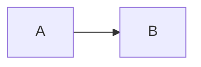

# Alpha

周五**发布**，请关注 [[团队]]。

- 准备清单
- 第二项

1. 第一步

2. 第二步

- [ ] 写迁移
- [x] 审 skill

> [!WARNING]
> 不要覆盖已有笔记。

| 项 | 状态 |
| --- | --- |
| 脚本 | 通过 |

```ts
const ok = true
```



$$
E = mc^2
$$

行内 $a^2$ 与高亮 ==重点==。


相对链接 [旧稿](./old.md)。


